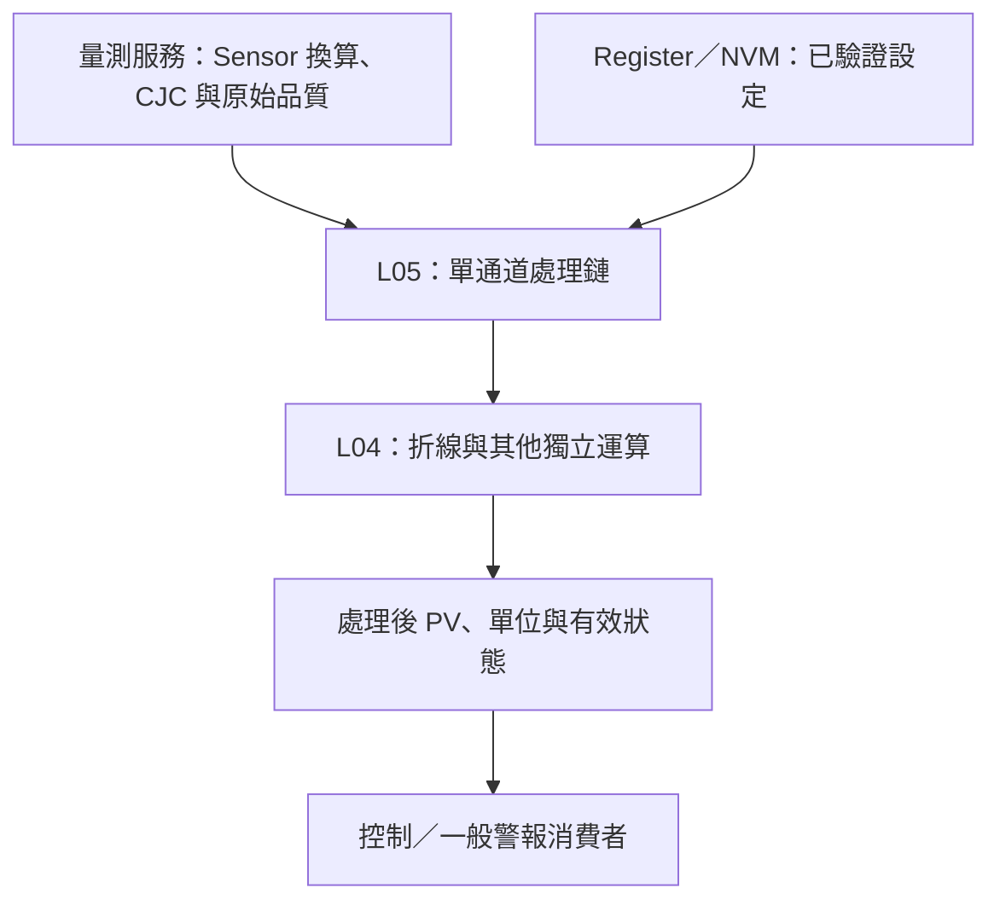

# DTDM04 輸入參數與輸入折線表對照（暫存規劃）

## 摘要

實作更新：L04 已新增 FbInputLinearization_Execute（FbSignalLinearization.h），完成 BYPASS／VALUE／DEVIATION、可選 Offset、輸出 CLAMP／ERROR 限制及有效性處理，並通過 Host 驗證。以下「未實作」敘述保留原規劃背景；以 [正式包裝契約](../../_Modules/PlatformCore/L04_FunctionBlock/Utility/FbSignalLinearization/README.md) 為目前 L04 狀態。L05 處理鏈、Register／NVM 及 MCU 仍未完成；DTDM04 Low／High 語意不作推定。

Register 將折線表歸於 Input Module 是參數分類，並不決定程式層級。依本專案架構，Sensor Driver 不加入使用者折線表；感測器物理換算／CJC 留在量測鏈，通用折線運算留在 L04，L05 配置單通道處理鏈與點表。Register／NVM 仍走既有服務。

現有 FbLinearization 為無狀態、可變點數、嚴格 X 遞增的線性內插核心，具 CLAMP／ERROR 邊界政策；尚未有完整輸入折線 Value／Deviation、PV Offset 組合與產品 adapter。本次僅補文件，未修改演算法。

此圖只表達責任關係；濾波、Gain、Scaling、Offset、折線的精確順序待定，不以圖示推定 DTDM04 已確認順序。既有 Safety 的 Sensor 異常與保護來源不因一般 PV 處理而被旁路。

## 折線表位址與欄位

使用者提供四個輸入通道：基底 B 分別為 1170h、1194h、11B8h、11DCh，間距 24h。以下偏移為十六進位；只供手冊對照，不直接沿用為產品 Register。

| 偏移 | 欄位 | 定義 |
|---|---|---|
| +00 | Enable Input Linearization | 0=停用、1=啟用、2=啟用且含 PV Offset；預設 0 |
| +01 | IL Operation Type | 0=Value、1=Deviation；不能與輸出折線的內插／步階選項混用 |
| +02／+03 | IL Input／Output Value | RO，依來源為 0.1°C、HiRes 0.01°C 或類比無單位 |
| +04 | Input Low Limit | 預設 -32000 |
| +05～+12 | Input Point 1～14 | 預設皆 0 |
| +13 | Input High Limit | 預設 32000 |
| +14 | Output Low Limit | 預設 -32000 |
| +15～+22 | Output Point 1～14 | 預設皆 0 |
| +23 | Output High Limit | 預設 32000 |

上述數值範圍皆 -32000～32000（S16）。表格有 14 組中間點與四個 Low／High 欄位，**不能只由名稱就斷言它是 14 點或 16 個插值節點**：Low／High 是否為端點對、限制值或其他邊界語意仍需確認。亦未提供有效點數欄位。

## 建議獨立的輸入折線功能契約（未實作）

- 重用現有 FbLinearization 內插核心；Value 建議輸出 f(x)，Deviation 建議輸出 x+f(x)。Deviation 表中 Y 應明確表示補償量，與絕對溫度分開換算。
- 產品模式明確命名為 BYPASS／VALUE／DEVIATION，PV Offset 另設選項。DTDM04 的 enable=2 是組合設定，無須讓共用核心接受產品特有編碼。
- BYPASS 建議輸出有效輸入 x；這是功能停用政策。現有通用 FbLinearization enable=false 會回傳無效及 0，不能直接接成量測鏈的旁路。
- PV Offset 加在何處、enable=1 是否排除它、Gain／Scaling 是否先於折線，必須明訂並測試；禁止在量測服務與 L05 重複加 Offset。
- 預設 X 全 0 不符合現有嚴格遞增要求。採顯式有效點數與嚴格驗證，或在外層依明確規則整理點表；不因預設為 0 就把 0°C 節點當成未使用。
- 原盤點依手冊描述非遞增點可跳過；現有核心採拒絕。保留嚴格核心，產品是否提供相容整理器需另決定，不能默認完全相容。
- 點數由呼叫端指定，不在 L04 寫死四通道或 14 點。Low／High 若確認是端點，可在外層建立完整表；確認前不自動插入。
- 明確指定輸入超界為夾住／無效／外插何者；現有核心只支援前兩者。輸出上下限與 Deviation 相加、PV Offset 的順序亦需分別定義。
- 輸入異常／過期不得當成正常數值內插；保留原始 PV、處理後 PV、品質與設定版本，便於控制與診斷辨識。

溫度處理維持專案 0.001°C 目標；一般表值轉內部 ×100，HiRes ×10，但 Low／High 與點表的確切單位仍須確認。現有核心採 float 呼叫端單位，若以 milli°C 數值呼叫，須驗證整條鏈的表示、捨入與精度；不能宣稱 float 介面自動保證任意範圍的 0.001°C 精度。類比無單位值不得套用溫度倍率。

## Input Module 其餘欄位的分工與疑點

| 功能 | 分工／需確認事項 |
|---|---|
| Input Type（1100～1103） | 量測配置／SensorConversionService；欄位上限 22 卻列出 30～44 HiRes，資料不一致。使用本產品 Sensor code，不直接照抄 |
| PV-F／PV-R（1104～110B） | 濾波配置；係數與範圍名稱不足以推定 IIR 方程或「範圍外旁路」規則，不等同 AD7124 SINC4 |
| PV Offset（110C～110F） | 使用者偏移調整；與工廠硬體校正及折線補償分開 |
| PV Gain（1110～1113） | 預設 0、倍率 0.001，不能直接假設 y=g×x，否則預設輸出為 0；是否 y=(1+g/1000)×x 等公式待確認 |
| Display Update（1114～1117） | UI 更新週期 0～100 秒；0 的語意未知，不作 Sensor／PID 執行週期 |
| AV／AC Scaling Low／High（1118～111F） | 類比工程量映射；display point 的實際單位與小數位需明訂，不和工廠校正混用 |
| CJC（1120～1123） | 量測換算；external 的數值來源與異常政策未提供，不能把使用者折線表當作 CJC |
| Input PV（1124～1127） | RO 量測結果；需確認是哪些修正前／後的階段。產品應另明確命名不同階段的診斷值 |

因此將整個 Input Module Parameters 都移成一個 FB 並不合適；應抽出可共用運算，保留通道配置與硬體責任的分界。

## 尚未完成與下一步

先確認處理順序、Value／Deviation／Offset、Low／High 節點語意、有效點與旁路，再設計單通道輸入折線 wrapper 及 Host 案例。必要案例包括節點相等／非遞增、0°C 合法節點、超界、正負補償、Offset 不重複、不同單位、停用旁路、無效輸入與設定原子套用。

來源：使用者提供 Input Module Parameters，以及現有 L04 Utility/FbLinearization.h。此文件是架構規劃，不是已完成清單。
