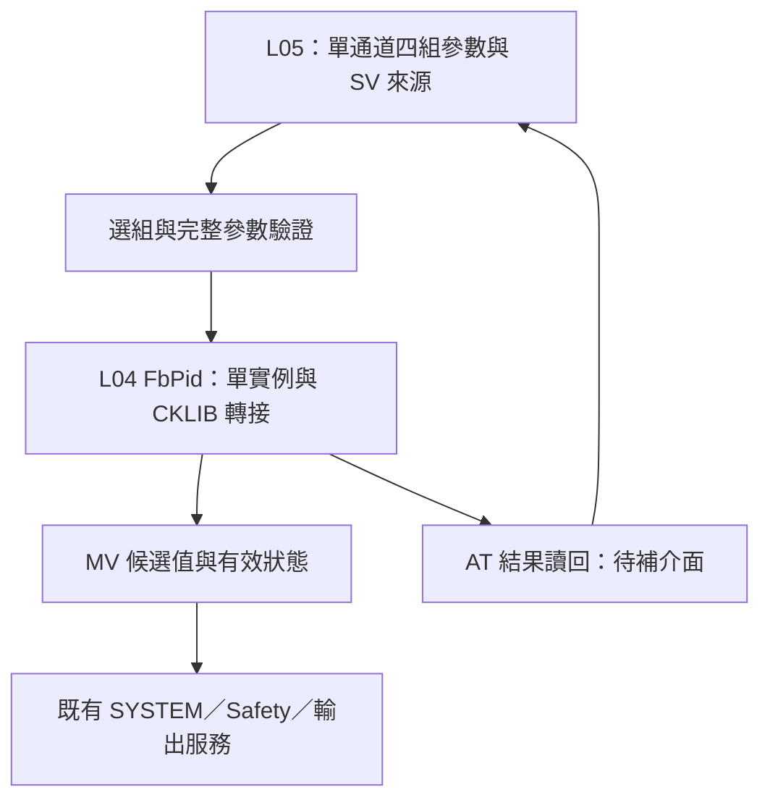

# DTDM04 PID 參數與既有架構對照（暫存規劃）

## 摘要

使用者提供的 PID Parameters 確認每個控制通道有四組 PID 參數，可手動指定或依 SV 自動選組。此文件僅整理規格與設計建議，未新增程式，未宣稱與 DTDM04 完全一致。

目前 L04 FbPid 已包裝 CKLIB 的 PB／Ti／Td、冷卻側參數、IOF 與 2DOF 係數；L05 只呼叫 L04，符合既有分層。四組參數管理、選組、整組套用、AT 結果回寫及切組狀態銜接仍未完成。實體 CKLIB .a 仍是空檔，數值功能尚未驗證。

2052h 已補齊：PID Update Period，0=1 秒、1=100 ms、2=10 ms，預設 0。PID 參數表另將 Ti／Td 的單位指向此設定，因此不能只視為顯示刻度。CKLIB Ti／Td 檔頭標為秒，後端的參數精度與執行週期仍須分別確認；2DOF 係數表列 0～200，但 CKLIB 檔頭列 1～100；目前 PID 溫度介面為 0.1°C，尚未符合專案 0.001°C 目標。

## Register 對照

位址依使用者提供資料，均為十六進位；不沿用為本產品位址承諾。

| 範圍 | CH1 | CH2 | CH3 | CH4 | 定義 |
|---|---|---|---|---|---|
| 一般／作用中參數區起點 | 1500 | 1510 | 1520 | 1530 | PB、Ti、Td、C-PB、C-Ti、C-Td、IOF、Alpha、Beta、Gamma，偏移 +0～+9 |
| 目前 PID 組別（RO） | 1038 | 1039 | 103A | 103B | 0～3 對應 Group 1～4 |
| 組別管理區起點 B | 1540 | 1570 | 15A0 | 15D0 | 以下偏移以 B 為準 |

一般參數區與四組儲存區的連動、寫入是否改寫目前組別、Auto 時是否允許修改，僅靠此表無法確認；產品建議區分「已儲存參數」與「實際套用參數」並提供版本／套用狀態，避免雙重寫入來源。

| 偏移 | 欄位 | 規格 |
|---|---|---|
| +00 | PID Group Selection | 0～3 固定組別，4=Auto；預設 0 |
| +01～+03 | 切至 Group 2／3／4 的 SV | S16，-9999～19999，預設皆 19999；一般溫度單位 0.1°C／°F |
| +04 + 6g | PB，g=0～3 | 1～30000，預設 300 |
| +05 + 6g | Ti | 0～30000，預設 120 |
| +06 + 6g | Td | 0～30000，預設 30 |
| +07～+09 + 6g | C-PB／C-Ti／C-Td | 同熱側範圍與預設，只在加熱／冷卻模式有效 |
| +1C + 5g | IOF | 0～1000，預設 0，單位 0.1% |
| +1D～+1F + 5g | Alpha／Beta／Gamma | 0～200，預設 45／100／30；表未註明倍率 |
| +20 + 5g | 隱藏參數 | 未知用途，不對外開放、不推測內容 |

上列偏移為十六進位；式中的 6、5 為每組欄位間距。第一區 150A～150F 等標示 Reversed／hidden parameter，不能將字樣解讀為 Reverse 控制方向。

## 參數與刻度

| 參數 | 現有 FbPid／CKLIB 入口 | 尚需處理 |
|---|---|---|
| PB／C-PB | FB_PID_PARAMETER_PB／COOL_PB | 表列一般 0.1°C、HiRes 0.01°C；CKLIB PB 檔頭未明列單位，需確認與 PV／SV 尺度一致 |
| Ti／Td、冷卻側時間 | TI／TD／COOL_TI／COOL_TD | 2052h：0=1 秒、1=100 ms、2=10 ms；CKLIB 檔頭標秒，後端精度仍未確認 |
| IOF | IPRELOAD | 名稱及用途相近，但 CKLIB 描述內部預載計算為 ipreload×pb×ti/1000；需實體驗證啟動／Reset 行為 |
| Alpha／Beta／Gamma | 同名入口 | 不以名稱推定完整 2DOF 方程；CKLIB 列倍率 0.01、範圍 1～100，與表列 0～200 不一致 |

專案溫度目標維持 0.001°C：一般表值轉內部 ×100；HiRes PB 表值轉內部 ×10。例如 PB=300 在一般刻度代表 30°C，內部為 30000。不能將 30000 直接傳入目前 0.1°C 後端並期待同等控制。

L04 公開工程量介面與後端刻度的統一仍待修改；CKLIB 特定單位轉換應封裝在 L04，L05 不引用 CKLIB 檔頭。後端只支援 0.1°C 時，必須明訂捨入與可達解析度，不能宣稱實際演算法已有 0.001°C 精度。PB 必須保持正值，禁止換算後變成 0。

時間建議在產品參數模型以明確 ms 表示，再由 L04 轉換為後端支援單位。整數秒入口不能精確表示 120×10 ms=1.2 秒；不得靜默截成 1 秒。需要確認實體 CKLIB 是否有其他精度設定，否則拒絕不支援設定並回報原因。Ti／Td 是演算法參數，與 L05 callback 週期、CKLIB PERIOD（檔頭單位 10 ms）分開處理。

### 2052h：更新週期與參數時間刻度

使用者補充 PID Update Period（PID 控制更新週期），位址 2052h、U8、可讀寫、範圍 0～2、預設 0：

| 設定值 | PID 更新週期 | Ti=120 依 PID 表刻度換算 | Td=30 依 PID 表刻度換算 |
|---|---|---|---|
| 0 | 1000 ms | 120 秒 | 30 秒 |
| 1 | 100 ms | 12 秒 | 3 秒 |
| 2 | 10 ms | 1.2 秒 | 0.3 秒 |

以上時間換算依兩張表合併解讀，尚不代表 CKLIB 接受相同原始數值。補充列另註「連動取樣週期（200Ch）為 0=10 ms」，尚不能推定所有選項都會強制改寫 200Ch，或已知其完整連動規則。

專案建議分開保存 PID period_ms 與 Ti／Td 的實際時間（ms）。修改更新週期時保留已設定的物理積分／微分時間；若要求複製 DTDM04 原始值連動效果，應由相容層明確換算，不能無聲改變調校結果。這是專案建議，並非已確認的 DTDM04 修改行為。

L05 依選定週期排程，L04 設定 CKLIB PERIOD 與支援的時間參數；底層 Sensor 取樣維持獨立契約。現有 Alarm／Logic 的 20 ms callback 不可直接當成 PID 全部週期：選 10 ms 必須有 10 ms 執行路徑，並處理新樣本／資料年齡及逾期策略，不能以同一時間點補跑兩次代表兩筆量測。此處尚未修改排程或控制程式。

## 四組選擇與切換契約（建議，未實作）

- 四組資料由 L05 單通道配置管理；需要跨專案重用時，可抽出不依賴 Register 的選組元件。基礎 FbPid 仍維持單一控制實例。
- Auto 明確使用 SV，不改用 PV；SV1／SV2、Ramp Soak dynaSV、Cascade 副控 SV 何者作為判定值，必須由 L05 的有效 SV 資料鏈定義。
- 建議區間為 SV<T2 選組1；T2≤SV<T3 選組2；T3≤SV<T4 選組3；SV≥T4 選組4。等號、相同門檻、升降方向是否有遲滯，尚非表格已證明的行為。
- 三個門檻預設相同，故不能直接把「由小到大」解讀為必須嚴格遞增；產品必須決定採非遞減並允許空區間，或改用嚴格遞增及新的合法預設。
- 驗證整組熱／冷與 IOF／係數後，於控制計算邊界一次生效；逐項 setter 失敗不可留下半套參數。需準備失敗回復或安全停用流程，現有 API 尚未提供交易式套用。
- 切組不能每週期 Reset 積分；保留狀態也不等於無擾切換。需確認 CKLIB 參數更新是否重算／清除狀態，並評估積分追蹤與 MV 連續性。初版可限制 STOP 時套用，但須明確標為專案限制，不宣稱運轉中 Auto 切組已完成。
- Action 的 PID Group +1／+2／-1 必須定義 Auto 時行為及邊界（拒絕／飽和／循環），不能自行假設。切組後實際組別獨立回報。

## AT、持久化與驗證缺項

AT 應固定目標組別並避免執行中 Auto 切組；完成後先讀回及驗證結果，經既有參數套用／NVM 流程更新指定組別。現有 FbPid 可回報完成，但未提供完整 AT 參數讀回／四組儲存流程，不能只看到 completed 就宣稱已完成回寫。

必要驗證涵蓋：四組地址／欄位對應、門檻等號與相同值、SV 來源切換、時間單位轉換、負溫與 PB 精度、熱冷參數、整組套用失敗、AT 組別鎖定與結果回寫、切組輸出連續性。實體 .a 及 MCU 驗證前，mock 僅證明呼叫流程。

## 待補資訊

1. 200Ch 已提供：0=10 ms、1=50 ms，預設 1；2052h 的完整連動規則及修改時 Ti／Td 何者保持仍待確認。詳見 [系統／串機參數](DTDM04_SYSTEM_MAPPING.md)。
2. Auto 判定 SV 的明確來源、門檻等號／相同值與遲滯規則。
3. 一般參數區和四組儲存區之讀寫關係；AT 寫入哪組。
4. CKLIB 實體版本／參數規格，尤其時間解析度、PB 單位、2DOF 係數範圍及狀態轉移。

來源：本次使用者貼出的 PID Parameters、L04 Control/FbPid.[ch]、CKLIB/INC/dt_pid_controller.h、L05 product_pid_controller_adapter.[ch]。本表作為功能參考；本產品架構與確認後的契約優先。
