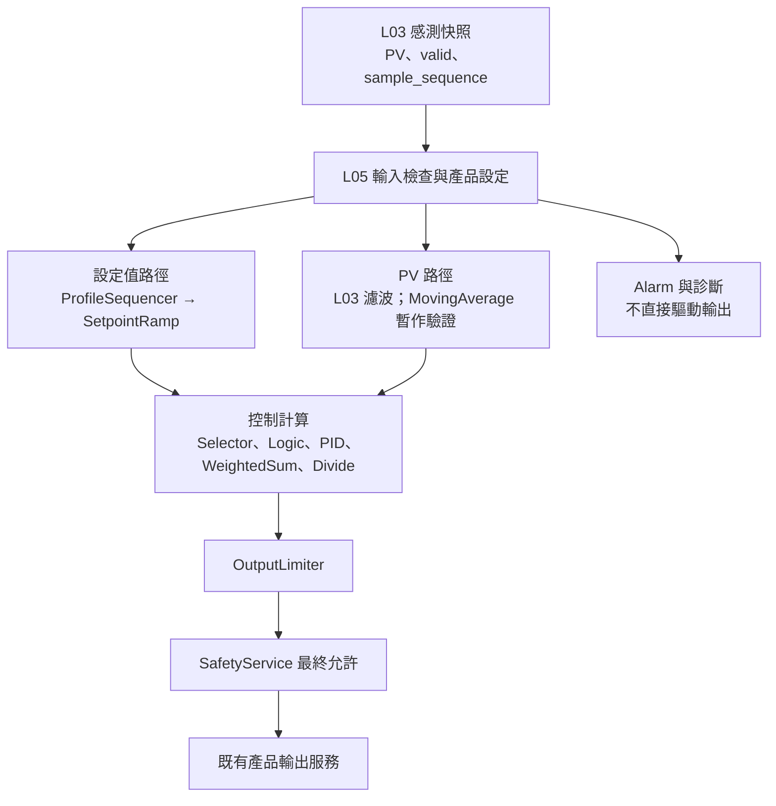

# L05 各 FB 串接規劃（暫存）

> **狀態：暫存規劃，尚未審核定案。**
> 本文件僅供討論，不代表功能已完成或已正式納入產品控制流程。
> 目前只新增此文件；未修改程式、未提交或推送。

## 目的與範圍

規劃各 L04 Function Block 在 L05 Product Application 的呼叫位置、資料流、執行順序與驗證階段。主程式以 `myNXPs16_Prj/branch2_ver1` 為準；L04 子模組使用 `_Modules/PlatformCore`（`platForm/branch1_systemPlatform`）。`myNXPs16_Prj/branch_1_ver1` 不納入本次工作。

L05 負責產品層的資料取得、FB 狀態與設定管理、呼叫編排及結果交付；不在 L05 重寫 L04 演算法，也不讓一般 FB 取代 SafetyService 或既有輸出服務。

## 建議資料流

此圖為建議架構，實際 FB 介面、PID 實作、SafetyService 與輸出服務呼叫點仍須以 `branch2_ver1` 目前程式確認後定案。

## 各 FB 的預定位置

| FB／功能 | L05 串接位置 | 暫存規劃與待確認事項 |
|---|---|---|
| `FbProfileSequencer` | 設定值來源 | 依配方／程序步驟產生目標值；確認產品配方來源、步驟計時及停止／暫停行為。若只更新狀態，可由主控制鏈按週期呼叫。 |
| `FbSetpointRamp` | 設定值路徑，接在目標值來源之後、PID 之前 | 限制設定值變化速度。確認 Profile 與 Ramp 的順序、單位、重置和手動切換行為。 |
| `FbMovingAverage` | PV 路徑 | 目前 CH0 adapter 為驗證用途，使用 `sample_sequence` 避免同一筆樣本重複加入；輸出暫不送入 PID 或輸出鏈。L03 已有中位數／IIR 濾波，正式採用前須評估重複濾波造成的相位延遲。 |
| `FbSelector` | 控制鏈輸入選擇 | 選擇有效 PV、設定值或備援來源。先定義優先順序、無效來源處理及切換是否無擾。 |
| `FbLogic` | 控制許可／產品邏輯判斷 | 輸出供產品流程或控制鏈使用；不可取代 SafetyService 的安全判斷及最終輸出抑制。 |
| PID | 主控制計算 | 使用有效 PV 與斜坡後 SV 計算原始輸出。確認實際 PID 實作、輸入／輸出範圍、積分重置、anti-windup 與 `dt` 契約。 |
| `FbWeightedSum` | 控制運算內 | 僅在控制策略需要合成多個項目（如 PID 與前饋）時使用；確認每項單位、係數及飽和處理。 |
| `FbDivide` | 控制運算內 | 僅在比例或正規化需求處使用；定義除數為零、錯誤狀態與結果範圍處置。 |
| `FbOutputLimiter` | 控制計算後、輸出服務前 | 限制輸出上下限或變化率。確認輸出工程單位、參數來源、停機／模式切換時狀態重置；其後仍須經 SafetyService。 |
| `FbAlarm` | 警報判斷支線 | 讀取明確指定的 PV／SV 與警報設定，將結果交產品警報／通訊服務；不直接操控輸出。手冊功能差距（例如動作延遲）須另行確認，不因接入 L05 即視為完整。 |
| `FbHeaterResistance` | 低優先診斷 | 使用時間對齊且有效的電壓／電流資料；定義無效資料、溫度補償和計算週期。 |
| `FbBatchMetrics` | 低優先統計 | 收集有效樣本並於產品定義的批次邊界彙總；確認重複樣本、批次重置與資料保存方式。 |
| `FbProcessResponse` | 低優先製程診斷 | 讀取控制輸入與 PV 變化評估製程響應；不可阻塞控制或安全路徑。 |
| `FbRecordTrigger` | 低優先記錄支線 | 產生記錄條件／事件，交既有記錄機制處理；快速事件不能只依賴慢速輪詢。 |

## 排程與呼叫原則

1. **主控制鏈共用同一輪資料與時間基準。** Profile／設定值更新、輸入有效性檢查、PV／SV 選擇、控制計算及輸出限幅依固定順序執行。
2. **運算型 FB 優先在控制 callback 內依序呼叫。** `Selector`、`Logic`、`WeightedSum`、`Divide`、PID 與 `OutputLimiter` 通常不必各自建立排程工作，避免不同步讀取資料。
3. **量測驅動與時間驅動 FB 分清楚。** 量測驅動 FB 應依 `sample_sequence` 或明確新樣本旗標避免重複消費；計時／程序 FB 則依其時間契約更新。
4. **週期先作規劃值，不視為規格。** PID、斜率與輸出限制可先以同一控制週期評估；診斷／統計可較慢執行。最終週期由 ADC 新樣本率、製程時間常數、MCU 執行時間與閉迴路測試決定。
5. **callback 不阻塞、不配置動態記憶體，也不在 Tick ISR 呼叫。** 逾期處理、`elapsed_ms`、超時及固定／可變 `dt` 的限制須遵守排程器和 FB 契約。
6. **安全路徑獨立且優先。** 診斷、記錄或警報任務不能延遲 SafetyService；最終輸出允許仍由既有安全與輸出服務管理。

## 建議分階段串接與驗證

| 階段 | 工作 | 驗證重點 |
|---|---|---|
| 0. 介面盤點 | 依 `branch2_ver1` 確認 L03 快照、FB header/API、PID、SafetyService、輸出服務及當前排程呼叫點。 | 形成每個 FB 的輸入／輸出、單位、狀態所有權與錯誤處理對照表。 |
| 1. 控制鏈骨架 | 建立 L05 控制鏈的資料快照、固定呼叫順序及 adapter/context 管理；不先啟用硬體輸出。 | Host 測試確認呼叫順序、無效輸入、重複樣本及時間間隔行為。 |
| 2. 設定值與 PV | 串接 Profile／Ramp；評估 MovingAverage 是否只作驗證或正式成為控制 PV。 | 設定值步階／斜率測試、PV 濾波延遲與樣本有效性測試。 |
| 3. 控制計算與限幅 | 接入 PID 及必要的 Selector、Logic、WeightedSum、Divide，最後接 OutputLimiter。 | 邊界、錯誤、除零、飽和、模式切換、`dt` 變化及 anti-windup 測試。 |
| 4. 安全與產品輸出 | 將限幅後結果交既有 SafetyService／輸出服務，不繞過既有輸出權限。 | 安全禁止、感測器失效、MCU 過溫及輸出失效時確認輸出安全狀態。 |
| 5. 警報與診斷 | 接入 Alarm、HeaterResistance、BatchMetrics、ProcessResponse、RecordTrigger。 | 確認不阻塞控制、安全路徑；驗證事件、批次邊界和錯誤資料處理。 |
| 6. MCU 整合 | 在目標板量測執行時間、最大延遲、週期抖動與資源使用，再做產品閉迴路驗證。 | 以實際 ADC 新樣本率和製程測試結果決定正式週期與啟用清單。 |

## 暫存結論

目前方向是先建立一條可測試的 L05 控制鏈，再逐類接入 FB；不把所有 FB 一律當成獨立排程任務。MovingAverage 的 CH0 串接先維持驗證用途，待確認 L03 濾波策略與控制需求後再決定是否納入正式 PV 路徑。正式實作前先完成階段 0 的介面盤點，避免依規劃圖假設尚未存在的產品 API。
