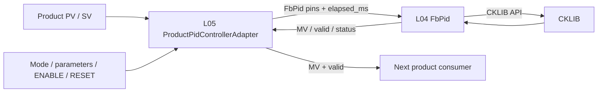

# PID Controller L04/L05 Integration

## Summary

L04 owns the reusable `FbPid` function block and is the only layer that includes or calls CKLIB. L05 maps product PV/SV and configuration into `FbPid`, invokes it on the product schedule, and publishes MV plus validity/diagnostics. L05 must not include CKLIB headers or expose CKLIB handles. The adapter is not yet connected to a product PV source, output consumer, or schedule registration.

## Block diagram

## Responsibility and interface

| Layer | Responsibility | CKLIB dependency |
|---|---|---|
| L04 `FbPid` | Public reusable pins, controller mode/configuration, parameter setters, lifecycle, execution, status/output mapping | Direct dependency; CKLIB handles remain private to `FbPid.c` |
| L05 `ProductPidControllerAdapter` | Product sample provider, sample freshness, scheduled elapsed time, product configuration mapping, forwarding output and diagnostics | None |
| Consumer | Accept MV only when valid; apply product/safety limits and perform output write | None |

L04 supports four modes: AutoTune (with PID or PID-FB target), On/Off, PID, and PID-FB. `FbPid_SetParameter()` forwards semantic parameter IDs to CKLIB setters so callers do not depend on CKLIB parameter enums or handles. PV/SV use CKLIB's 0.1 °C representation. The L05 sample provider must normalize product sources to this unit (for milli-degrees Celsius, divide by 100 with an agreed rounding rule) before returning the sample. Reject non-temperature inputs unless a separate scale mapping is specified.

`ProductPidControllerAdapter_Process(context, elapsed_ms)` matches the L05 schedule callback contract. L05 reads the sample provider, checks optional maximum sample age (`0` disables freshness checking), passes elapsed time to L04, and exposes the resulting MV and validity. General controller modes convert elapsed milliseconds to CKLIB's 10 ms step units, rounded to the nearest unit. AutoTune has no elapsed-time argument and requires the configured period/tolerance to match the actual scheduled callback.

`enable` is level-sensitive. Disabling clears the output and resets active L04 state once; re-enable begins from reset state. `reset` is rising-edge triggered and suppresses output for that scan. Invalid, unavailable, stale, or mistimed input invalidates output; consumers must ignore MV while `valid == false`. SafetyService and the output service remain responsible for final permission and hardware writes.

## CKLIB include and link dependency

CKLIB headers include dependencies using `cklib/inc/...`; L04 provides compatibility include wrappers under `CKLIB/Include/cklib/inc` around the supplied headers in `CKLIB/INC`. No CKLIB include path or wrapper belongs in L05.

`CKLIB/Lib/libcklib.a` is intentionally a zero-byte placeholder because the physical archive cannot be uploaded. Host unit tests use CKLIB test doubles and do not require that archive. A target firmware link requires the matching real CKLIB archive locally at this path; do not commit the binary unless distribution is explicitly approved.

## Host unit test

Build the L04 FB and L05 adapter unit test with C99 warnings enabled. Coverage includes the four controller factory modes, ENABLE/DISABLE and RESET transitions, elapsed-time conversion, stale/unavailable input, AutoTune timing, and AutoTune-to-PID handoff. The host test does not validate the real CKLIB binary or MCU behavior.
