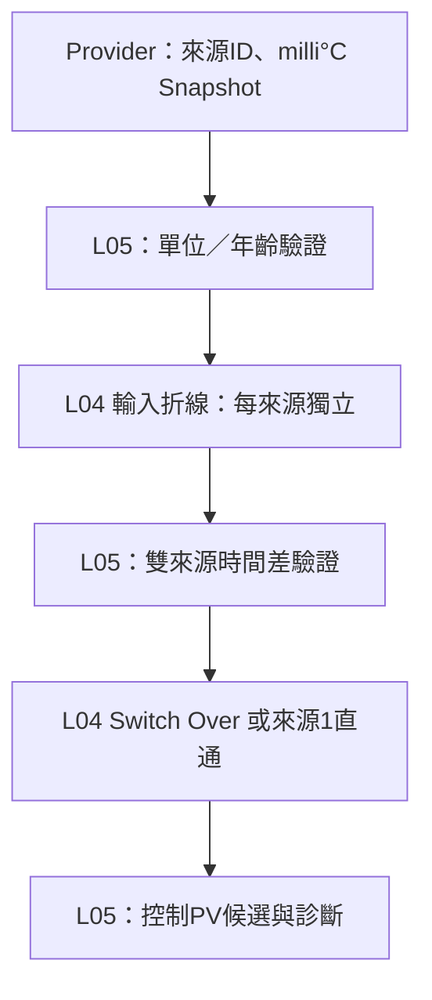

# L05 溫度PV處理鏈

## 摘要

已完成單條產品PV處理adapter與Host整合驗證：provider→品質／單位／時效→各自輸入折線→雙來源時間差→Switch Over／單來源→控制PV候選。支援多個獨立adapter，不綁定四通道。

**正式Sensor Snapshot provider、20ms CH0排程及Alarm的明確來源選擇已接入；正式PID、Register／NVM、實體輸出與MCU驗證仍未完成。** 預設旁路來源CH0、不開啟Switch Over，Alarm預設仍讀原始PV；不改寫原始Sensor工程值，Snapshot新增處理時間中繼資料。

來源：[adapter介面](../Source/L05_Application/product_pv_processing_adapter.h)、[實作](../Source/L05_Application/product_pv_processing_adapter.c)。不引用CKLIB、板級Driver或寄存器位址。

## 參數與呼叫

| 參數／API | 契約 |
|---|---|
| source[2] | 抽象來源ID，由provider解析；相同ID可用但不代表冗餘 |
| linearization[2] | 每來源獨立L04設定，全部X／Y／Offset為milli°C；啟用點表需2～64點，旁路忽略點表 |
| switch_enabled | false只讀來源1，不呼叫來源2 provider；true處理兩來源 |
| switch_config | 既有L04故障／切換門檻；溫度0.001°C |
| maximum_age_ms | 必須1～INT32_MAX，拒絕過期／未來時間；不可無限保持舊樣本 |
| maximum_skew_ms | 0～maximum_age_ms；雙來源皆健康但時間差超過時，兩者都標UNALIGNED，禁止假裝單側故障而降級 |
| Init | 驗證整組、複製Config並綁定provider；失敗留下未初始化adapter |
| SetConfig | 先完整驗證再複製，失敗保留原Config／輸出／歷史；成功清除切換歷史並回RESET狀態 |
| Process(now_ms,enable,reset) | 外層以同一單調毫秒時鐘呼叫；disable／Reset清歷史、零無效且不呼叫provider |
| GetOutput | 取得當次候選值與逐來源診斷；未初始化或NULL回false |

所有設定與輸出儲存體不可和adapter重疊。SetConfig會複製設定但不複製點表；點表須由呼叫端持有且不可改動，直到成功套用另一組設定。沒有動態配置或執行緒鎖，預期主迴圈單一擁有者。

## Provider與單位／時間

provider每次依source ID填入ProductPvSourceSample：int32 value、timestamp_ms、sequence、unit、valid。只接受PRODUCT_PV_MILLICELSIUS；V／mA或無單位值不因型別相同就混入溫度鏈。

provider要從同一時間基準提供已保存的原始Snapshot，而不是更新其timestamp來偽裝新資料。L05以uint32(now−timestamp)計age，支援正常毫秒回繞；時鐘偏差／未來值依age拒絕。假定取樣與now的可判讀範圍小於半個uint32週期，跨模組時鐘同步由provider／資料服務負責。

兩來源的資料須由provider保證一致快照／時間標記；重複sequence可重算無狀態折線，但會依原timestamp過期。output.timestamp_ms是本次發布時間，不是新Sensor取樣時間；消費者必須看逐來源raw.timestamp／sequence及valid，不能將發布時間當Sensor新鮮度。

## 數值與品質處理

輸入BYPASS直接保留int32，不經float轉換。Value／Deviation轉入既有float核心前檢查該整數可精確表示，若不能則SOURCE_PRECISION，不無聲捨去1個milli°C；這不宣稱整條float運算在所有範圍都有1milli°C精度。

折線輸出先轉double做四捨五入，半格離零，確認仍在int32內才轉型。超範圍為SOURCE_RANGE，L04配置／邊界拒絕則SOURCE_LINEARIZATION。之後由Switch Over決定取單側或平均，平均沿用L04朝零取整契約。

單側失效可依USE_OTHER降級，KEEP則依已選來源決定有效性；雙側失效／時間不一致回零無效。每來源診斷包含原始Sample、age、processed、valid與status：UNAVAILABLE／INVALID／UNIT／STALE／UNALIGNED／PRECISION／LINEARIZATION／RANGE。未讀取的來源2診斷不作使用，呼叫端依switch_enabled判讀。

單來源直通沒有Switch Over的sensor_low／high檢查，合法Sensor範圍由provider／既有量測服務負責。adapter不覆寫硬體Snapshot或把invalid舊PV提供控制。

## Host驗證摘要與細則

執行：`python _Product/Tests/run_pv_processing_tests.py`。可加`--sanitize`，本環境需`ASAN_OPTIONS=detect_leaks=0`（LeakSanitizer受/proc限制）。使用C99、Wall/Wextra/Werror與ASan／UBSan通過。

| 案例 | 驗證結果 |
|---|---|
| 來源1折線 | 200000經+1000折線得到201000，原Sample仍200000 |
| 雙來源平均 | 201000與300000得到250500 |
| 單來源故障 | USE_OTHER切到300000並degraded |
| 時間對齊 | skew等於10ms接受，超過時兩側無效，不假降級 |
| age與回繞 | age100接受、101拒絕，正常uint32回繞接受，未來timestamp拒絕 |
| 單位／provider失敗 | 非溫度與來源不可用分別回診斷原因 |
| 設定整組拒絕 | age0、點數1不套用，保留原設定 |
| KEEP及實例獨立 | BOTH時失去一側不假平均，另一新實例仍按來源1初始化 |
| Reset／disable | 清歷史且不回舊控制值 |
| float精度 | 16777217在折線模式拒絕、旁路原值保留 |
| int32轉換界限 | float結果2147483648拒絕，不做未定義轉型 |
| 生命週期／NULL | 未初始化與必要參數安全處理 |

## 下一階段待辦

1. 已接正式SensorMeasurementSnapshot provider、CH0固定週期排程與Alarm來源選擇；PID來源與刻度／後端仍未接，不能只因getter有值就當已接閉迴路控制。
2. MCU上驗證時間／來源品質、資源及唯讀結果，再開放產品模式。
3. 定義點表／來源與單位的Register Pending／Apply、NVM；目前SetConfig只是記憶體交易，不是通訊套用或持久化。
4. 完成MCU建置／資源／實測；任何處理後PV使用仍遵守既有SYSTEM／Safety權責。

本次已將.cproject中原本排除的FbLinearization.c加入可編譯來源，供adapter依賴；專案XML語法已驗證，尚未實際執行MCUXpresso建置。

## 正式provider與排程增補

ProductSensorMeasurementService_ProcessAt(channel,now_ms)已由ProductApplication量測迴圈呼叫，Snapshot增加processed_timestamp_ms與processed_timestamp_valid。同樣本序號重讀不更新時間；失效後同一序號恢復也不刷新。這是原始ADC Sample在量測服務首次處理的時間，不是硬體擷取時間；AnalogInputSample目前沒有擷取時間戳，無法據此證明ADC到服務之前的延遲。

舊Process(channel)仍可用於舊呼叫與測試，但新序號經無時間入口處理時，不會虛構有效時間；正式PV provider拒絕無有效時間的Snapshot。產品不應混用兩種入口期待所有舊樣本都能補成新時間。OFF與初始化會清除Snapshot時間資訊。

provider以產品SensorType白名單只接受TC／RTD；valid、timestamp valid、input_error==0與conversion_flags==0都必須成立。V／mA不能只靠engineering_value型別相同就通過。年齡上限預設200ms、雙來源時間差20ms；預設來源CH0、折線BYPASS、Switch Over=false。

排程共20項：CH0 PV處理→Alarm／Logic鏈→原18項設定表。Alarm可由來源API選用同次排程的處理結果，預設仍為原始PV。晚到的排程仍使用Snapshot儲存時間計age，不能以發布時間刷新資料。

- ProductFbScheduleIntegration_GetCh0ProcessedPv()讀取處理後PV與逐來源診斷。
- ProductFbScheduleIntegration_ConfigureCh0PvProcessing()驗證本機來源ID與整組設定後套用；目前本機通道數沿用PRODUCT_AL_CHANNEL_COUNT，非遠端路由或Register介面。
- SetConfig成功會清除舊Switch Over歷史；失敗保留。量測值／Snapshot本身不被覆寫。

## CH0 Alarm的來源選擇

`ProductFbScheduleIntegration_SetCh0AlarmPvSource()`支援RAW／PROCESSED，GetCh0AlarmPvSource查目前設定。只作用於CH0全部Alarm，其他通道維持原始Sensor來源；這是記憶體API，不是新Register。Init每次回RAW，未開放NVM自動恢復。

切換實際來源前要求CH0所有Alarm的enabled=false；相同來源的no-op可成功。接受切換會清除該通道Alarm執行歷史、舊峰值、待執行Reset／Clear命令及資料年齡，保留各Alarm設定與SV。這是來源重配置，不是一般運行中Alarm Reset；需由外層有意停用、配置、再啟用。Logic結果按下次既有排程更新，不會在setter內重跑整條Logic。

Alarm使用PROCESSED時，ConfigureCh0PvProcessing亦要求CH0所有Alarm先停用，避免運行中改變點表／來源。配置先完整驗證，拒絕時不變更；成功清除相關歷史。原始模式時允許調整唯讀處理鏈，不影響原始Alarm。

處理結果必須valid且是本次排程發布的資料，否則無效；不退回RAW。預設兩鏈同為20ms且PV在前，若日後更改Alarm週期導致該次沒有PV執行，會保守判無效，必須一併規劃排程相位。

Alarm樣本身分由實際貢獻的來源sequence／儲存timestamp、目前selected與處理後PV變更判定；僅發布時間改變不增加序號。每個貢獻來源仍須通過PRODUCT_AL_MAX_SAMPLE_AGE_MS（非零時）及PV處理鏈自身年齡上限；剛切來源亦不能把已過期資料當新資料。此序號僅為記憶體週期身分，非耐久事件ID。

test_product_processed_alarm_source.c已驗證RAW25°C不觸發、PROCESSED35°C觸發、啟用中拒絕換來源／改處理鏈、停用後清峰值與歷史、重複發布不刷新、舊資料／無效時間不回退RAW，以及Init回RAW。納入run_alarm_logic_tests.py --sanitize，既有Alarm／Logic與MovingAverage測試一併通過。

新增test_product_pv_schedule_integration.c已驗證實際排程釋放、預設旁路、折線、Switch Over、過期與恢復、單位／錯誤／時間有效性、回繞及原Snapshot不變。run_alarm_logic_tests.py --sanitize、run_factory_calibration_tests.py（含ProcessAt時間測試）、MCU/run_host_checks.py（僅Host，trace分析7例）均通過；不代表MCU時序驗證完成。
