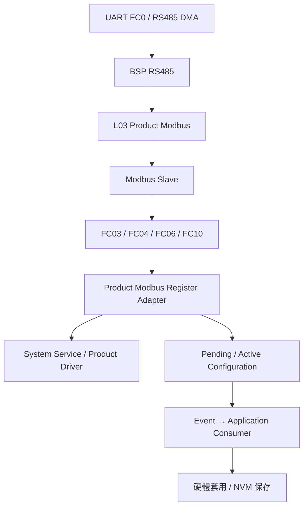
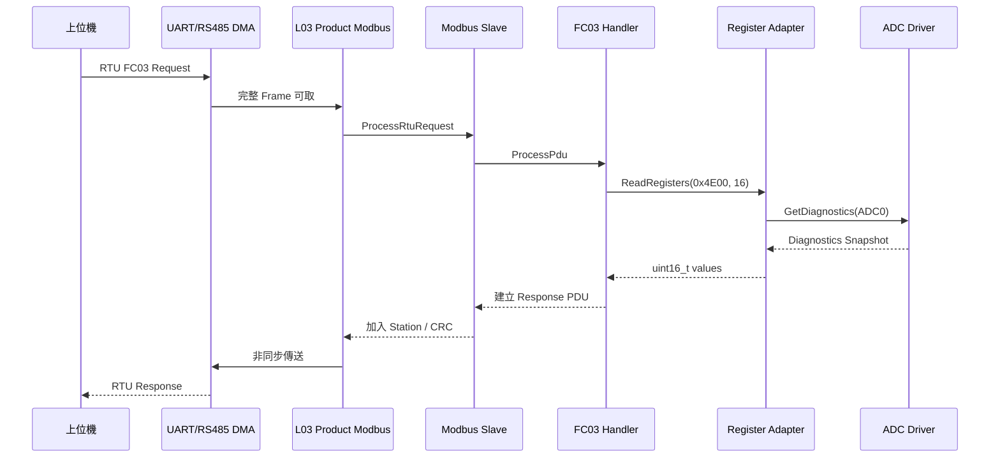

# Register Map 至 UART Modbus 呼叫流程

## 摘要

目前 Register Map 並不是由 CSV 自動產生 C code。

- `_Product/RegisterMap/register_map.csv` 是通訊規格與文件來源。
- `_Product/Source/L03_System/product_modbus_register_adapter.h` 定義真正參與編譯的 Product Register 位址。
- `_Product/Source/L03_System/product_modbus_register_adapter.c` 負責把 Register 位址轉成實際系統資料或設定操作。
- Modbus Slave 收到 FC03、FC04、FC06 或 FC10 後，透過 callback 呼叫 Product Register Adapter。
- UART DMA 與 ISR 負責搬移資料及通知事件；Modbus 解碼、Register 存取與 Application 邏輯在 foreground 主迴圈執行。

因此 `register_map.csv`、C header、C implementation、診斷工具與測試必須保持同步。

## 1. 整體架構



| 層級 | 用途 | 主要檔案 |
|---|---|---|
| Register 規格 | 定義地址、型態、權限及 NVM 屬性 | `_Product/RegisterMap/register_map.csv` |
| Product Adapter | 把地址轉換成實際資料與操作 | `product_modbus_register_adapter.h/.c` |
| Modbus Protocol | 解析 FC03、FC04、FC06、FC10 | `ModbusSlave.c`、`ModbusFunction*.c` |
| Product Communication | 管理 RTU/ASCII、回應延遲及 Port 狀態 | `l03_product_modbus.c` |
| Serial/HAL/Driver | 執行非同步傳送、DMA 與 RS485 DE/RE 控制 | `SerialService.c`、`product_rs485_driver.c`、`product_rs485_dma.c` |

## 2. Register 位址定義

### 2.1 規格文件

Register 規格表位於：

```text
_Product/RegisterMap/register_map.csv
```

此 CSV 不會直接被 compiler 編譯，也沒有自動產生 Register Adapter 的流程。

### 2.2 Product Register 定義

真正參與編譯的 Product Register 位址位於：

```text
_Product/Source/L03_System/product_modbus_register_adapter.h
```

例如 ADC 診斷區：

```c
#define PRODUCT_MODBUS_ADC_DIAGNOSTICS_BASE_ADDRESS  0x4E00U
#define PRODUCT_MODBUS_ADC_DIAGNOSTICS_STRIDE        0x0040U
#define PRODUCT_MODBUS_ADC_DIAGNOSTICS_COUNT         0x0040U
```

| ADC | 診斷起始位址 |
|---|---:|
| ADC0 | `0x4E00` |
| ADC1 | `0x4E40` |
| ADC2 | `0x4E80` |
| ADC3 | `0x4EC0` |
| 診斷區最後位址 | `0x4EFF` |

### 2.3 UART 通訊設定 Register

Platform 通用 UART Register 定義於：

```text
_Modules/PlatformCore/L03_SystemPlatform/MiddlewareAdapter/ModbusRegisterAdapter.h
```

FC0 的基址為 `0x1200`：

| Offset | 內容 |
|---:|---|
| `+0x00` | Baud code |
| `+0x01` | Data bits |
| `+0x02` | Parity |
| `+0x03` | Stop bits |
| `+0x04` | RTU/ASCII protocol |
| `+0x05` | Slave/Master role |
| `+0x06` | Station ID |
| `+0x07` | Timeout |
| `+0x08` | Apply key |
| `+0x09` | Apply status |
| `+0x0A` | Revision |
| `+0x0B` | Response delay |

UART 參數的驗證、Pending/Active configuration 與 Baud code 對照實作於：

```text
_Modules/PlatformCore/L03_SystemPlatform/MiddlewareAdapter/ModbusRegisterAdapter.c
```

## 3. Register Adapter 接入 Modbus Slave

Product Register Adapter 的實作位於：

```text
_Product/Source/L03_System/product_modbus_register_adapter.c
```

`ProductModbusRegisterAdapter_GetInterface()` 將 Product callback 掛入 Modbus Slave：

```c
interface->read_holding_registers = ReadRegisters;
interface->read_input_registers = ReadRegisters;
interface->write_single_register = WriteSingleRegister;
interface->write_multiple_registers = WriteMultipleRegisters;
interface->context = &s_registerContext;
```

Modbus Core 因此不需要知道產品具有 ADC、DAC、PWM、Sensor 或 NVM。Modbus Core 只呼叫抽象介面：

```c
registers->read_holding_registers(...);
registers->write_single_register(...);
registers->write_multiple_registers(...);
```

Product Adapter 再依 Address Range 決定實際資料來源或設定目的地。

## 4. Register 讀取流程

`ReadRegisters()` 依 Address Range 進行路由，例如：

```c
if (IsTemperatureInputRangeValid(...))
{
    /* Build temperature input register image. */
}
else if (IsAdcDiagnosticsRangeValid(...))
{
    ReadAdcDiagnostics(...);
}
else
{
    return MODBUS_EXCEPTION_ILLEGAL_DATA_ADDRESS;
}
```

Register Adapter 不是一個單純的 `uint16_t register[65536]`。大部分資料是在收到讀取要求時，由 Context、System Service 或 Product Driver 即時組成 Register Image。

| Register 類型 | 主要資料來源 |
|---|---|
| Temperature PV | Sensor Measurement Service 更新至 Register Adapter Monitor |
| ADC diagnostics | Product ADC Driver diagnostics snapshot |
| UART configuration | Serial active/pending configuration context |
| PWM/DAC/DI/DO | 對應的 System Service 或 Product monitor/context |
| Fault/Event diagnostics | FaultService、EventService 或診斷 snapshot |

例如量測服務會更新：

```c
ProductModbusRegisterAdapter_SetTemperatureInputMonitorForChannel(...);
```

Application 取得設定時會呼叫：

```c
ProductModbusRegisterAdapter_GetTemperatureInputConfigForChannel(...);
```

## 5. FC03 讀取至 UART 回文流程

假設上位機送出：

```text
Station       = 2
Function      = 03
Start address = 0x4E00
Quantity      = 16
```

實際流程如下：



### 5.1 Modbus Slave dispatch

`ModbusSlave.c` 驗證站號、CRC/LRC 與封包長度後，依 Function Code 分派：

```text
FC03 → ModbusFunction03_Process()
FC04 → ModbusFunction04_Process()
FC06 → ModbusFunction06_Process()
FC10 → ModbusFunction10_Process()
```

### 5.2 FC03 Handler

`ModbusFunction03.c` 解碼起始位址與數量：

```c
address = DecodeUint16(&request[1]);
quantity = DecodeUint16(&request[3]);

exception = read_registers(
    context,
    address,
    quantity,
    values);
```

此處的 `read_registers` callback 就是 Product Adapter 的 `ReadRegisters()`。

回傳的 `uint16_t` 最後以 Modbus Big Endian 順序放入 Response PDU。

## 6. FC06／FC10 寫入流程

### 6.1 FC06 單筆寫入

```text
UART Request
→ ModbusSlave_ProcessRtuRequest()
→ ModbusFunction06_Process()
→ Product WriteSingleRegister()
→ Pending configuration
→ Apply key
→ EventService
→ Product Application Consumer
→ 硬體套用／NVM 保存
```

### 6.2 FC10 多筆寫入

FC10 可一次寫入多個 Register，適合將參數與 Apply Key 放在同一個 Modbus transaction 中。

例如 CH0 Temperature Input configuration：

```text
0x1007 = Sensor code
0x1008 = CJC source
0x1009 = Apply key 0xA5A5
```

可使用 FC10 從 `0x1007` 一次寫入三個 Register，避免參數只更新一部分。

### 6.3 Exception 回覆

| 條件 | Modbus Exception |
|---|---|
| 位址不存在或跨越非法區域 | `0x02 Illegal Data Address` |
| 值、格式或 Apply Key 不合法 | `0x03 Illegal Data Value` |
| 內部服務無法完成 | 對應 Server Failure |

## 7. UART 初始化與執行路徑

UART Modbus 初始化入口位於：

```text
_Product/Source/L03_System/l03_product_modbus.c
```

`L03_ProductModbus_Init()` 依序執行：

1. 建立 FC0 UART 設定。
2. 設定 Baud、8N1、RTU/ASCII、Role 與 Station ID。
3. 初始化 `SerialConfigurationApplyService`。
4. 設定 RS485 t1.5、t3.5 與 turnaround timing。
5. 呼叫 `ProductModbusRegisterAdapter_GetInterface()` 掛入 Register callbacks。
6. 啟動 UART DMA 接收。

目前主要預設值來自：

```text
_Product/Config/ProductConfig.h
```

目前 FC0 預設：

```text
Protocol       = Modbus RTU
Baud rate      = 115200
Slave address  = 2
Response delay = 0 us
```

## 8. UART 回文傳送路徑

回文傳送流程：

```text
L03 Product Modbus
→ SerialConfigurationApplyService_WriteResponse()
→ SerialService_Write()
→ HalSerial_WriteAsync()
→ Product RS485 Driver
→ UART DMA
→ RS485 DE/RE control
```

主要檔案：

```text
_Modules/PlatformCore/L03_SystemPlatform/SystemService/
    SerialConfigurationApplyService/SerialConfigurationApplyService.c

_Modules/PlatformCore/L03_SystemPlatform/Communication/
    SerialService/SerialService.c

_Product/Source/L01_ProductDriver/product_rs485_driver.c
_Product/Source/L01_ProductDriver/product_rs485_dma.c
_Product/Source/L02_BSP/bsp_rs485.c
```

UART 參數收到 Apply Key 後不會立即切換。系統會先使用舊設定完成目前 Modbus 回文，確認 TX 已完成後再套用新的 Baud、Parity 或其他通訊參數，避免回文傳送途中改變 UART 格式。

### 8.1 FC0 RX 與 TX 的差異

- FC0 Slave RX 使用 `BspRs485_*` DMA/Frame API，保留 RTU frame gap 與 DE/RE 時序控制。
- TX 經過 `SerialConfigurationApplyService → SerialService → HalSerial → Product RS485 Driver/DMA`。
- ISR/DMA 只負責資料搬移與事件通知；Modbus parse 與 Register callback 在 foreground 執行。

## 9. 主迴圈與週期定義

主迴圈位於：

```text
source/myNXPs16_Prj.c
```

核心結構：

```c
while (1)
{
    ProductRs485Driver_Process();

    while (elapsed_tick >= 10U)   /* 10 × 0.1 ms = 1 ms */
    {
        L03_ProductModbus_Tick1ms();
        L03_ProductModbusMaster_Tick1ms();
        ProductApplication_Tick1ms();
    }

    ProductUsbModbus_Process(usbTimeMs);
    L03_ProductModbus_Process();
    L03_ProductModbusMaster_Process();
    ProductApplication_Process();

    ProductWatchdogDriver_Process(g_systemTick100us);
}
```

執行特性：

- SysTick 基準為 `0.1 ms`。
- Modbus 計時器每 `1 ms` 更新。
- `L03_ProductModbus_Process()` 每次 foreground loop 都會執行。
- UART DMA 完成後只通知有 frame 可處理。
- Register 讀寫、事件派送、NVM 與 Application 邏輯不在 UART ISR 中執行。

## 10. USB Modbus 共用 Register Map

USB Modbus 初始化時同樣呼叫：

```c
ProductModbusRegisterAdapter_GetInterface(&slave.registers);
```

因此 USB Modbus 與 UART Modbus 使用完全相同的 Register Adapter 與地址邏輯，差異僅在 Transport Layer。

```text
UART Modbus ─┐
             ├→ Product Modbus Register Adapter
USB Modbus ──┘
```

## 11. 新增 Register 的標準步驟

新增或修改 Register 時應同步執行：

1. 在 `_Product/RegisterMap/register_map.csv` 更新通訊規格。
2. 在 `product_modbus_register_adapter.h` 定義 Address、Count、Stride 或 Offset。
3. 在 `product_modbus_register_adapter.c` 增加 Address Range validator。
4. 在 `ReadRegisters()`、`WriteSingleRegister()` 或 `WriteMultipleRegisters()` 增加路由。
5. 串接真正的 System Service、Product Driver、Monitor 或 Application configuration。
6. 若需要 Apply，加入 Pending、validation、Active 與 Event 流程。
7. 若需要斷電保存，再串接 NVM consumer 與 NVM failure fault。
8. 更新 Python/C# 診斷工具。
9. 新增 Address boundary、Read/Write、Apply 與 Exception unit tests。

## 12. 設計原則

- Register Map 只負責通訊表示，不讓 Modbus Core 直接依賴產品硬體。
- Product Adapter 是 Modbus 與產品資料之間唯一的 Address Translation Boundary。
- 可寫設定先進入 Pending，通過完整驗證後才 Apply。
- 需要保存的設定由 Application/NVM 流程處理，不在 Modbus ISR 寫入 NVM。
- UART 設定必須等回文傳送完成後再切換。
- CSV、C 定義、診斷工具與測試目前需人工同步；若後續 Register 數量持續增加，可再評估導入 code generator。
