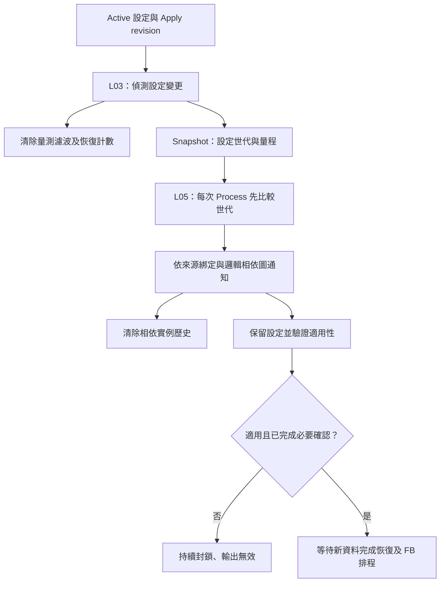

# 通道設定變更通知與 FB 恢復契約

更新：2026-11-27（台灣時間）。本功能由產品層 L03／L05 實作，PlatformCore 不變。

## 目的與通知來源

感測器輸入類型、CJC 或濾波設定改變後，下游 FB 不能只靠一次 `valid=false` 清除歷史。當 L03 已經完成恢復、L05 才再次執行時，仍須知道資料的設定背景已改變。

L03 Snapshot 新增 `configuration_revision`（32 位元）、`configuration_minimum`／`configuration_maximum`（名義溫度量程，0.001°C）及 `configuration_range_valid`。一般電壓／電流、OFF、未能解析的類型，其溫度量程有效旗標為 false。量程使用轉換表的名義範圍，不把量測允許的延伸區當作可設定控制界限。

每次 `ProcessAt` 讀取 Active 設定與原有的 16 位元 Apply revision。首次觀察、Apply revision 改變，或感測器類型／CJC 來源／CJC 偏移／濾波時間常數改變時，增加設定世代、清除 L03 中位數／IIR／連續有效計數，並隔離已觀察過的舊 ADC sequence。相同設定及相同 revision 的重複處理不產生通知。

即使兩次觀察之間發生 A→B→A，最終設定值相同，Apply revision 的差異仍能偵測變更。這是「最新設定狀態通知」，不是每次 Apply 都有一筆的事件佇列；中間多次變更可合併。原有 16 位元 Apply revision 若在兩次觀察之間恰好完整繞回、且設定值完全相同，無法辨識該次歷程；正常主迴圈不得長期停止設定消費。

`quality_revision` 仍專責斷線、過期、轉換失敗等品質失效。兩種世代用途不同。



## L05 實際依賴與執行時機

`ProductFbScheduleIntegration_Process()` 在呼叫排程器前執行通知傳遞。即使尚未到 20 ms FB 釋放時刻，也先清掉輸出快照及歷史。最新已交付的通知保存於 RAM，不需每個 FB 都剛好掃到 invalid。

| 實例 | 哪些通道會影響它 | 設定變更處理 | 恢復條件 |
|---|---|---|---|
| CH0 `FbMovingAverage` | 固定 CH0 | 清窗、輸出無效、清除 sequence 去重；保留原有視窗設定 | L03 新有效資料再開始收樣 |
| 各通道原始 PV Alarm | 該 Alarm 的通道 | 清延遲、遲滯、待機、鎖存、峰值、命令邊緣及 sample age；保留 Alarm config／SV／enable | 使用中的參數符合新溫度量程，且來源有效 |
| CH0 PV 折線／切換鏈 | `source[0]`；僅在 `switch_enabled=true` 時另依賴 `source[1]` | 清切換選擇與輸出、清 processed sample identity；保留曲線、門檻、路由 | 單來源 BYPASS 可依相容溫度來源恢復；啟用折線或切換時須重新設定確認 |
| CH0 processed PV Alarm | 上述 PV 鏈的實際來源，可能不是 CH0 | 清 Alarm 歷史及其下游邏輯；跟隨 PV 設定封鎖 | PV 設定確認、Alarm 參數有效且 processed PV 有效 |
| 啟用的 Logic | 實際配置的 Alarm／Logic 來源腳位 | 以固定點走訪清除所有間接相依歷史，含向前參照與循環；保留布林運算、反向、延遲與綁定 | 相依 Alarm 無參數封鎖、且各來源有效 |
| 僅依賴 DI／常數的 Logic | 無感測器通道依賴 | 保留既有歷史與輸出 | 原有 DI／運算規則 |
| 選用的 CH0 固定 MV PID 測試實例 | 固定 CH0 | 立即 Reset MV／狀態，保留 SV／MV 設定並設定待確認 | 明確呼叫 Configure，SV 適用新量程、MV 合法、來源有效 |

停用或 OFF 的 Logic 不作為相依傳遞節點。封鎖是逐 Alarm 實例計算，某一個 Alarm 的門檻越界，不會把同通道另一個合法 Alarm 的邏輯鏈一起封鎖。參數封鎖的傳遞在每次 Alarm／Logic callback 前，先完成整張相依圖計算，避免向前參照讀到上一輪有效值。

本實作涵蓋目前 L05 已接入的上述實例。其他尚未註冊或未連接的 FB 不會因此自動取得通知；新增鏈路時必須補上相依宣告／通知處理及測試。正式 PID／CKLIB 控制鏈並未因本次變更而啟用。

## 保留參數與驗證規則

### Alarm

- 絕對上／下限：只驗證該模式實際使用的絕對界限。
- 相對上／下限：驗證 SV 及 `SV + High`、`SV - Low`，只檢查該模式使用的界限。
- 上遲滯：驗證 `SV + High` 及 `SV + Low`；下遲滯：驗證 `SV - High` 及 `SV - Low`。
- 啟用待機功能時，SV 也必須在新量程內。有效界限以 64 位元運算，避免加減溢位。
- 原有 `SetAlarm` 仍負責模式、選項、延遲及參數結構合法性。新增規則不修改或夾限使用者參數。
- 每次 Alarm callback 重驗目前保留參數。修正 Alarm／SV 後可解除該實例的參數封鎖，但仍受來源有效與原有延遲條件限制。停用實例輸出保持 OFF。

例如 TC-K 改 TC-T 後，原 900°C 絕對上限仍保留，但因超出新名義上限 400°C 而封鎖。改成 300°C 後才可重新使用。TC 改 0–10V 時，溫度 Alarm 持續無效，不將原參數當作電壓參數運算。

設定變更會清除 Alarm 峰值與手動鎖存，避免混用不同量測背景；一般斷線的既有峰值保留規則不因本次改動而改變。這是 FB 歷史處理，不會清除 SystemFault／Safety 的系統鎖存。

### PV 折線與雙來源切換

啟用折線或切換的來源設定變更後，`g_pv_configuration_review_required` 會持續成立。來源重新 valid、時間經過或一般 Reset，都不視為重新確認。應由應用程式確認參數意義後，呼叫 `ProductFbScheduleIntegration_ConfigureCh0PvProcessing()`，可明確重新送入原設定或新設定。

重新設定檢查：

1. 原有曲線結構、節點數、單調 X、有限值、策略、切換順序及 age／skew 合法性。
2. 已開始發佈設定的來源必須可解析為溫度量程。
3. 使用中的折線 X 節點須位於各來源的新名義量程內。
4. 啟用切換時，`sensor_low`／`sensor_high` 外框須位於兩個來源各自的新名義量程內，切換點仍須位於外框內。

這是保守的設定契約；不自動縮放曲線、不夾限切換門檻。曲線 Y／偏移是否符合產品校正用途仍須由呼叫端明確確認，執行時保留原有有限值、單位、時間及數值範圍檢查。BYPASS processed Alarm 使用來源名義量程；經明確確認的折線／雙來源 processed Alarm 使用原有 L04 Alarm 數值範圍驗證，轉換後的產品控制界限由應用程式設定，不聲稱能從原感測器量程推得。

若 CH0 Alarm 正在使用 processed PV，重新設定 PV 鏈或改 Alarm 來源，仍要求 CH0 所有 Alarm 先停用。設定失敗不解除待確認旗標，也不套用部分參數。確認成功後重新啟用所需 Alarm。

### 選用 PID 測試實例

`PRODUCT_PID_CH0_TEST_ENABLED=1` 時，設定通知立即清 MV，並要求 `ConfigureCh0PidTest()` 明確確認；`ResetCh0PidTest()` 不解除此封鎖。Configure 先檢查新量程 SV 與 MV，再修改狀態；後續 SWD 改 SV 仍受新量程限制。此驗證僅涵蓋既有固定 MV 測試實例，不能當作正式 CKLIB 全部 PID 參數的驗證證據。

## 觀測介面

```c
ProductChannelConfigurationNotification notification;
ProductFbScheduleIntegration_GetChannelConfigurationNotification(channel, &notification);
/* configuration_revision、notification_count、moving_average_reset、pv_reset、
 * pid_reset、alarm_channels_reset：最新已交付通知；bit0 代表邏輯 CH0 Alarm。 */
ProductFbScheduleIntegration_IsCh0PvConfigurationBlocked();
ProductAlarmLogicAdapter_t *adapter = ProductFbScheduleIntegration_GetAlarmLogicAdapter();
/* adapter->alarm_blocked[ch][alarm]、logic_blocked[logic]：最近 callback 的封鎖狀態。
 * AlarmParametersValid() 可立即檢查目前參數，不必等下一次 callback。 */
```

以上均為主迴圈 API／RAM 診斷，本次沒有新增 Modbus 寄存器、NVM 格式或通訊寫入命令。最新通知不是所有歷史通知的紀錄。設定世代不等於 sample sequence，也不等於設定 consumer 的 ACK。

## Host 驗證與待驗證

執行：

```text
python _Product/Tests/run_sensor_recovery_tests.py --sanitize
python _Product/Tests/run_alarm_logic_tests.py --sanitize
python _Product/Tests/run_ch0_pid_test.py --sanitize
python _Product/Tests/run_factory_calibration_tests.py
python _Product/Tests/MCU/run_host_checks.py
python _Product/Tests/test_safety_evk_mode.py
```

新增案例包含：A→B→A、Apply revision 繞回、設定世代繞回、濾波時間改變、重複觀察不重送、未到 FB 釋放時間且 Snapshot 已 valid 仍立即清歷史、跨通道隔離、向前參照／間接 Logic、越界 Alarm 持續封鎖及修正恢復、相對遲滯界限、非溫度來源、未啟用第二來源不受影響、processed Alarm 隨實際來源清除、PV 明確確認及新外框拒絕、PID Reset 不能代替確認、SV 越界拒絕。

Host 結果為軟體行為證據。MCUXpresso Debug／Release／SafetyTest 完整建置、Flash／RAM 容量及正式板的感測器切換、連續有效樣本時序、PWM／DO 實體輸出仍列待驗證，不能由此推定上板通過。


## 一般 SV 更新與設定變更的區別

單純修改 SV 使用[統一 SetChannelSv](CHANNEL_SV_UPDATE.md)，不觸發本文件的清歷史通知，也不解除 PV／PID 的設定重新確認旗標。SWD 非法 SV 請求會被拒絕並保留舊目標，不再直接當成無效控制輸入。
