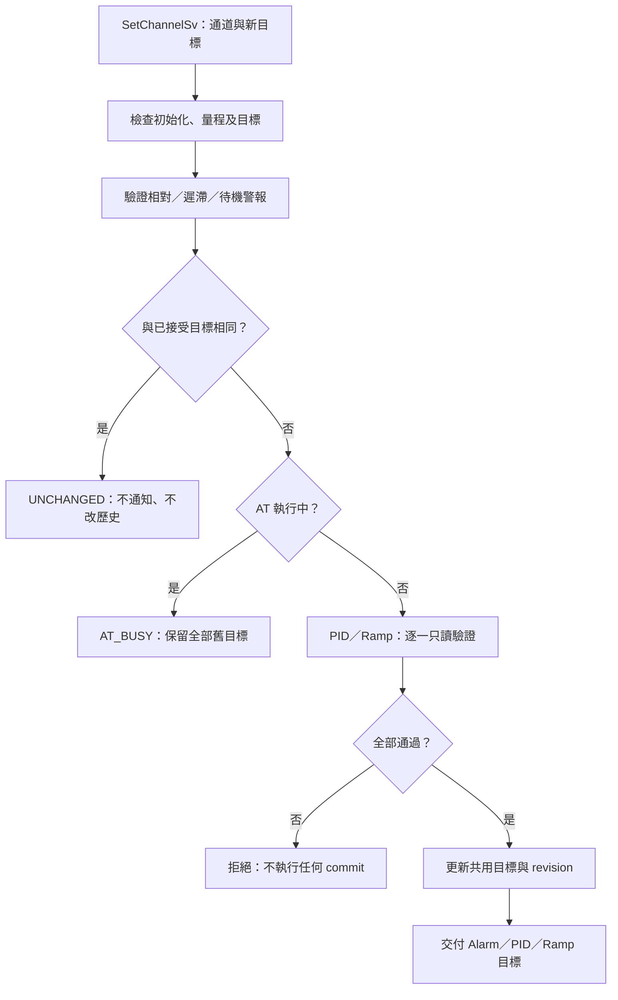

# L05 統一 SV 更新入口

更新：2026-11-27（台灣時間）。產品層實作；未修改 PlatformCore、NVM 格式或新增 Modbus 寫入位置。

## 公開入口與資料單位

```c
ProductChannelSvResult result =
    ProductFbScheduleIntegration_SetChannelSv(0U, 120000); /* CH0，120.000°C */

ProductChannelSv state;
ProductFbScheduleIntegration_GetChannelSv(0U, &state);
/* state.target：最後接受的目標，0.001°C
 * state.revision：成功變更次數；同值重送不增加
 * state.configured：是否曾接受有效目標 */
```

目標 SV 是一般運行輸入，不是感測器設定變更。正常更新不增加 L03 設定／品質世代、不使 PV invalid、不重算三筆有效恢復、不清中位數、IIR 或 MovingAverage。

初始化時沒有已接受的 SV，`configured=false`；內部數字零不代表使用者已設定 0°C。整合實例中，尚未設定 SV 的相對／遲滯／待機 Alarm 以及選用 PID 測試不使用這個零值運作。不依賴 SV 的絕對 Alarm 可依原規則運作。應用程式應在 L03 發佈設定量程後，恢復或設定有效 SV，再啟用相關控制。重複 Init 會清除 SV 狀態及外部消費端綁定。

## 驗證後才交付

所有 API 由同一主迴圈序列呼叫，不從 ISR 呼叫；「同步」指一次呼叫返回前，所有消費端目標已交付。FB 結果仍在各自下一次 callback 計算，不在 setter 裡重跑排程或操作硬體。



前置檢查依序為：

1. 初始化完成、通道合法且沒有重入中的 SV 操作。
2. L03 Snapshot 已能解析該實體通道的溫度名義量程；OFF、一般電壓／電流、未知或尚未發佈量程時拒絕。
3. 目標須位於名義量程內，含上下邊界；目前沒有另加一組使用者 SV Limit 寄存器。
4. 檢查所有啟用且依賴 SV 的 Alarm 之有效界限。使用目前 Snapshot metadata，不使用尚未交付通知的舊量程。
5. 新值與舊值相同時，回覆 UNCHANGED。此步驟之前仍會重新驗證量程及 Alarm，所以量程已改變的非法舊值不能靠同值重送通過。
6. 檢查綁定消費端的 AT 狀態，再執行全部 validate。只有全部成功才執行 commit。

即使 PV 因斷線或恢復中而無效，只要設定量程仍有效，仍可更新合法目標；此操作不會解除來源品質、Safety 或設定重新確認封鎖。

### Alarm 的候選 SV 檢查

| 模式 | 新 SV 必須符合的界限 |
|---|---|
| 相對上限 | `SV + High` |
| 相對下限 | `SV - Low` |
| 相對上下限 | 同時檢查以上兩者 |
| 上遲滯 | `SV + High`、`SV + Low` |
| 下遲滯 | `SV - High`、`SV - Low` |
| 絕對模式 | 絕對門檻不隨 SV 改變，不因這次 SV 更新重設它 |
| 啟用待機選項 | 另驗證 SV 位於 Alarm 的有效量程 |

相對／遲滯模式也要求 SV 本身位於其有效量程。加減採 64 位元運算，避免整數溢位誤判。單邊模式不驗證未使用的另一邊；停用 Alarm 或模式 OFF 不阻擋本次 SV。

CH0 Alarm 若使用 processed PV，單來源 BYPASS 依實際來源名義量程驗證；折線／雙來源鏈沿用已確認處理鏈的 L04 Alarm 數值範圍。處理鏈尚未確認、來源設定通知尚未消費或單位不相容時，依賴 SV 的 Alarm 會拒絕更新。實體通道目標仍須先符合該通道名義量程；本次未建立獨立的控制迴路來源／使用者 SV Limit 模型。

例如 TC-T 名義上限 400°C、相對上限偏移 10°C：SV=390°C 可接受，390.001°C 因有效上限超出 400°C 而拒絕；原 SV、PID／Ramp 目標與 Alarm 歷史均保留。

## 正常改 SV 保留哪些狀態

| 項目 | 行為 |
|---|---|
| Alarm 設定、峰值、手動鎖存、待機／遲滯狀態、待處理命令 | setter 不清除；下次運算依原規則處理 |
| Alarm 動作延遲 | 不因改 SV 一律歸零；下次條件仍成立可繼續，條件消失才依正常規則取消 |
| Logic | 不額外 Reset；在既有排程讀取新 Alarm 結果 |
| 量測濾波與 MA | 不清歷史，不重新計數 |
| PV 折線／切換鏈 | 不更改曲線、門檻、選擇歷史或設定確認旗標 |
| PID | 交付新目標，下一次運算讀取；SetChannelSv 不呼叫 Reset／Init／SetParameter |
| 未來 Ramp | 只更新 target；沿目前斜坡值前進，不呼叫 Init／Reset |

這不代表改 SV 後結果不變。例如相對警報條件可能消失，或 PID 下一次 MV 改變，均屬正常運算。固定 MV 測試後端不是數值 PID，本次不能藉此證明實際積分／微分反應或無擾切換品質。

## AT 規則：拒絕新目標，不自動中止

- AT 執行中且目標不同：回覆 `PRODUCT_CHANNEL_SV_AT_BUSY`，不寫入任何消費端，也不暫存待套用目標。
- 同值重送且量程／Alarm 檢查仍通過：UNCHANGED，不改變 AT。
- AT 完成或明確停止後，由呼叫端重新送出新目標。本次不提供「自動中止後重啟 AT」功能。
- `ProductPidControllerAdapter_IsAutoTuneRunning()` 判斷已初始化、L04 模式為 AUTO_TUNE、active 且尚未完成。它反映已運行的 FB 狀態，不把尚未開始執行的 AT 指令視為已運行。
- 外部 PID 必須提供 `at_running` callback；若其產品流程另有 AT 啟動等待狀態，也應在該 callback 中封鎖。

目前正式 CKLIB／AT 排程仍未啟用；Host 驗證涵蓋 AT 狀態判定與交易拒絕規則，未執行實際自動調諧。

## PID／Ramp 擴充契約

每通道有 PID、RAMP 兩個可選 slot，預設外部 slot 未綁定：

```c
ProductChannelSvConsumer consumer = {
    MyValidateSv,     /* 只檢查；成功回 PRODUCT_CHANNEL_SV_OK */
    MyCommitSv,       /* 只存入已驗證目標；不能失敗 */
    MyAtRunning,     /* PID 必填；Ramp 可為 NULL */
    &my_context
};
ProductFbScheduleIntegration_BindChannelSvConsumer(
    channel, PRODUCT_CHANNEL_SV_PID, &consumer);
```

`validate` 不得改變控制狀態、配置或硬體；`commit` 不得失敗、配置記憶體、清歷史、操作硬體或重入 SV API。callback 與 context 必須在綁定期間有效。重入 SetChannelSv 回 BUSY，重入 Bind 回 false。

尚未接受 SV 時，綁定不會呼叫 commit；外部 provider 也應等 `configured=true` 才啟用運算。已接受的 SV 在綁定時會先重驗目前量程／Alarm，再交給新消費端 validate／commit；拒絕時保留舊綁定。PID slot 缺少 AT callback 時拒絕綁定；舊或新消費端 AT 執行中也拒絕替換。以 NULL 解除綁定；應在停止狀態操作，避免中途改變控制路由。

未來 Ramp 的 commit 應只寫 `input.target`，PID 的 commit 應只保存目標供 provider 使用。若 PID 實際 SV 要選擇 Ramp 輸出，還需另接 Ramp 排程與運行 SV 路由；目前僅提供介面與實際 L04 Ramp 的 Host 介接測試，未啟用產品 Ramp 任務。

### 現有入口的整合

- 整合實例的 `ProductAlarmLogicAdapter_SetSetpoint()` 會透過 owner handler 轉入 SetChannelSv；獨立建立的 Alarm adapter 保留低階本地 setter。
- `PRODUCT_PID_CH0_TEST_ENABLED=1` 時，自動綁定 CH0 PID 測試 slot，禁止外部替換／解除。provider 使用統一已接受目標。
- `ConfigureCh0PidTest()` 先透過統一入口設定 SV，再執行原有固定 MV／enable 設定與明確 Reset。這仍是完整重新設定／確認入口；日常只改 SV 應使用 SetChannelSv。
- SWD 的 `g_ch0_pid_test_sv` 改為請求影子值：主迴圈送入統一入口，拒絕時恢復為舊目標。`g_ch0_pid_test_sv_result` 保存該次 SWD 請求結果；影子值與已接受目標相同時不產生新請求，結果可保留前次值。不可直接修改內部 adapter 的 setpoint／FB state 以繞過驗證。
- GetCh0PidTest 的 input 是最後一次 callback 使用的輸入。SetChannelSv 返回後，新目標已接受，但舊 input／MV 快照可維持到下一次 callback，這不是同步失敗。

## 結果碼

| 結果 | 意義 |
|---|---|
| OK | 所有檢查通過，目標及 revision 更新，消費端已交付 |
| UNCHANGED | 已接受的同值，無重新交付／歷史重設 |
| NOT_INITIALIZED | 整合層未初始化完成 |
| INVALID_ARGUMENT | 通道不合法 |
| RANGE_UNAVAILABLE | 無有效溫度設定量程 |
| OUT_OF_RANGE | 目標超出名義量程 |
| ALARM_RANGE | 相對／遲滯／待機使用條件不適用 |
| AT_BUSY | AT 執行中，拒絕新目標 |
| CONSUMER_REJECTED | PID／Ramp 的 validate 拒絕，沒有任何 commit |
| BUSY | callback 重入統一入口 |

前綴皆為 `PRODUCT_CHANNEL_SV_`。這些是 L05 回傳結果，本次沒有自動映射 Modbus exception 或新增通訊寄存器。後續 Modbus／UI 寫入入口應明確呼叫此 API 並處理結果，不直接改 adapter 欄位。

## 驗證與限制

```text
python _Product/Tests/run_alarm_logic_tests.py --sanitize
python _Product/Tests/run_ch0_pid_test.py --sanitize
python _Product/Tests/MCU/run_host_checks.py
python _Product/Tests/run_sensor_recovery_tests.py --sanitize
```

新增 `test_product_channel_sv.c`：名義邊界、單邊／雙邊相對警報、正負遲滯界限、64 位元防溢位、最新量程、兩階段交付順序、任一消費端拒絕、AT 忙碌與同值重送、綁定拒絕／重入防護、舊 setter 轉送、通道隔離、啟動未設定 SV 防護，以及 Alarm／Logic／MA／PV 歷史保留。另以真正 `FbSetpointRamp` 驗證更新目標後從 77°C 繼續斜坡至 79°C。

CH0 PID 測試確認：更新 SV 不清既有輸出或重跑 callback、下一次運算取得新 SV、非法 SWD 請求保留舊目標、一般改 SV 不解除感測器設定重新確認封鎖。

MCUXpresso Debug／Release／SafetyTest 完整建置、Flash／RAM 容量、正式 PID／AT 動態與實體輸出仍待驗證；Host 通過不能代替這些項目。
