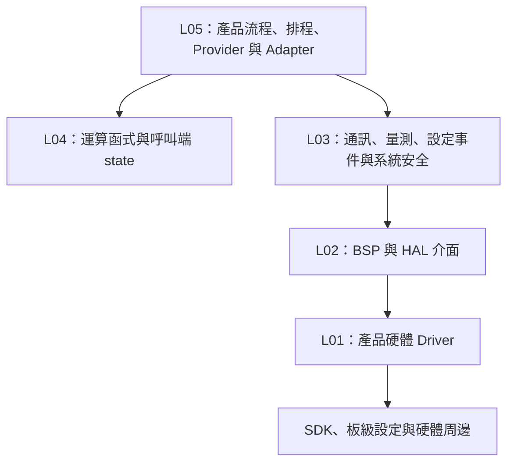
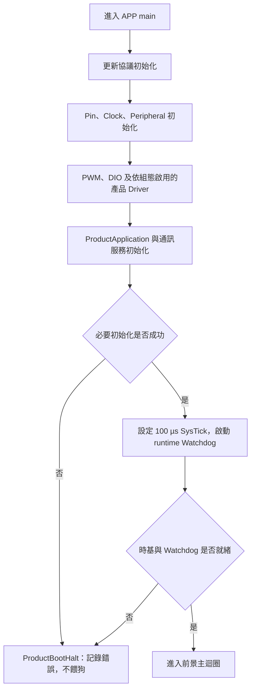
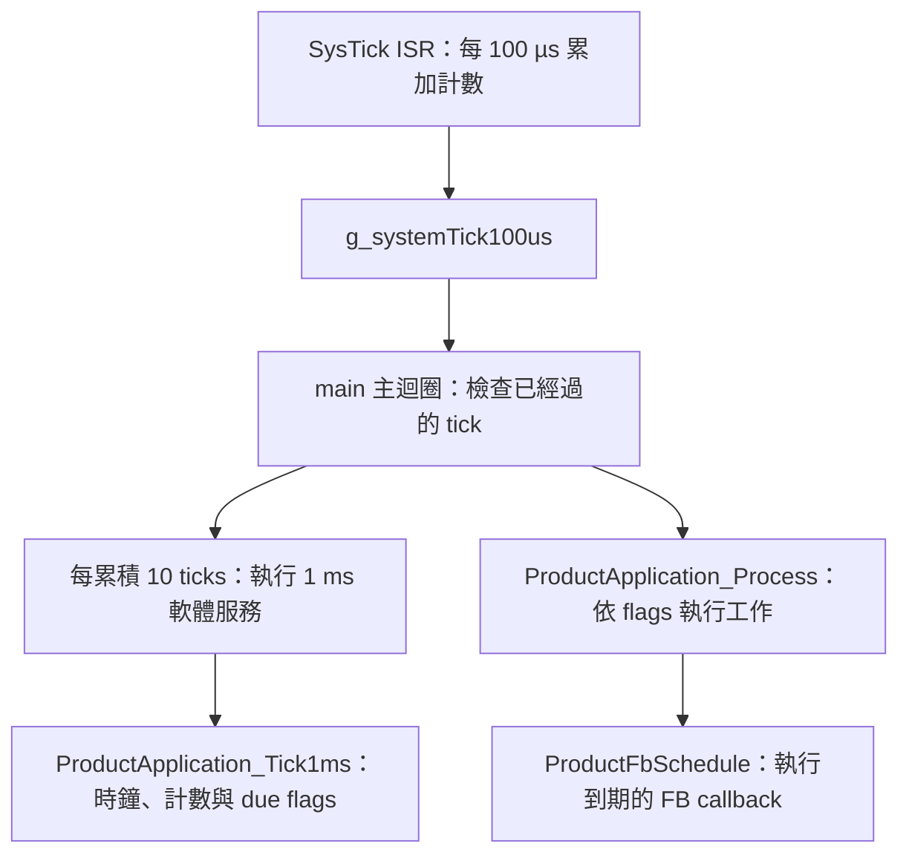
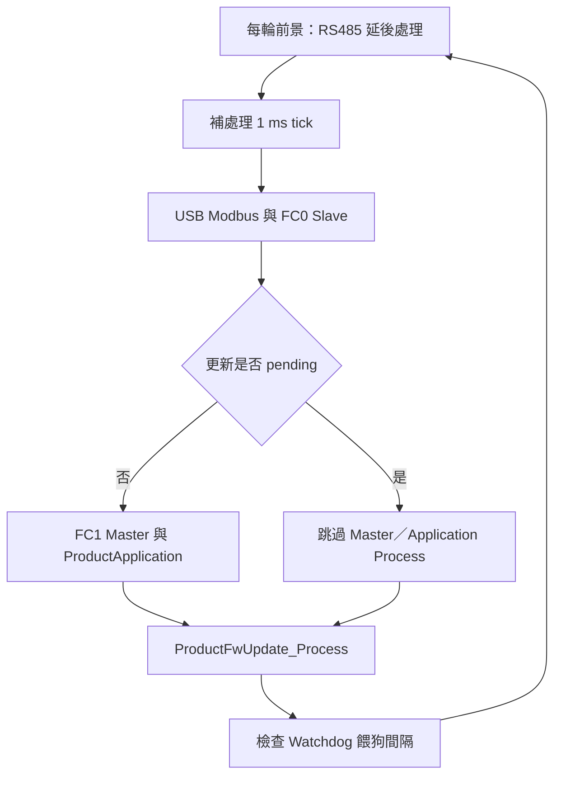
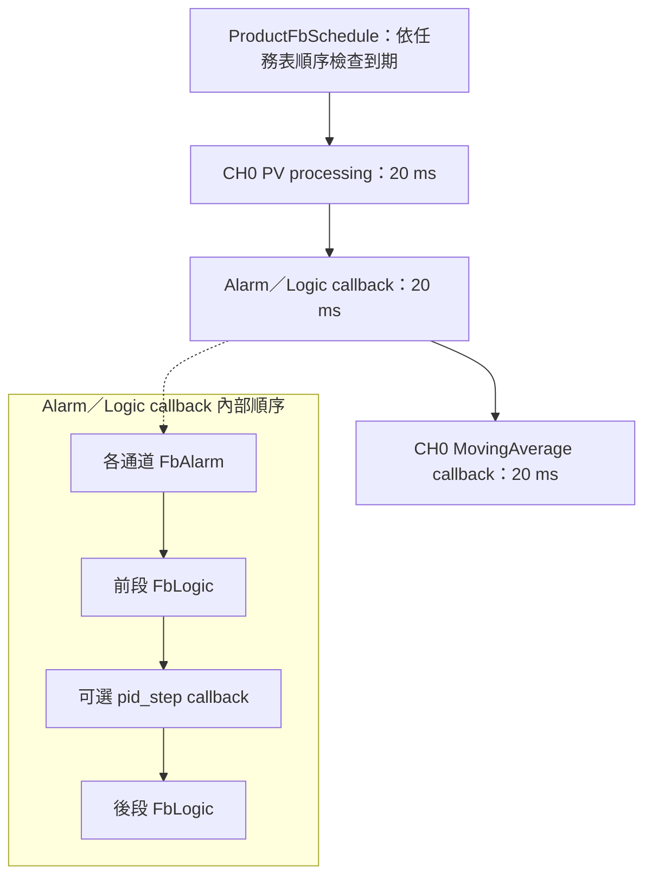
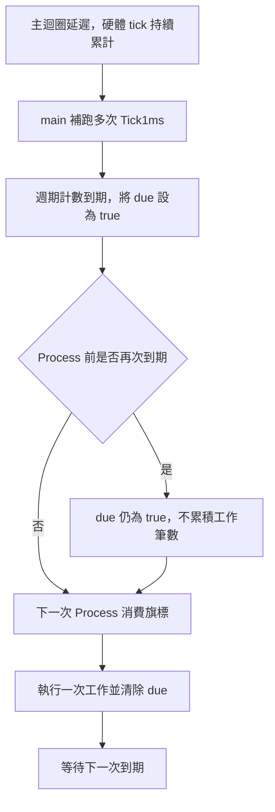

# 各層功能架構、主要函式與執行時機

## 1. 查核範圍與讀法

依 `branch2_ver2_directUpdate` 的 `dd342f14c3d9147cc664b582ab4ef49aa504ecb2` 與 PlatformCore 子模組 `73adb19bbb71016b4d4be750c5e42b2e33fa4a0c` 整理。本文列出 APP 的主要公開入口、排程 callback 與重要內部呼叫，不逐一列出 SDK 全部 API 或每個靜態輔助函式。Bootloader 是另一個程式，其內部排程不在本表範圍。

以下時間均指目前程式設定或觸發條件，不是量測完成的 WCET／最大延遲保證。建置巨集可以覆寫部分預設值，實際映像需同時核對該組態。

| 名詞 | 本文意義 |
|---|---|
| ISR | 硬體中斷上下文，可能打斷主迴圈 |
| 每輪主迴圈 | 每次 `while(1)` 走到該入口時呼叫，沒有固定毫秒週期 |
| 週期到期 | 主迴圈根據累積時鐘或 due flag 決定是否執行，可能有延遲 |
| 事件／命令觸發 | 收到封包、Apply、資料就緒或狀態改變才有實際工作 |
| 硬體週期 | ADC 轉換、PWM 波形等由周邊硬體運作，不等於 C 函式每次執行的週期 |

## 2. 分層功能與呼叫關係

| 層級 | 產品／共用程式位置 | 目前功能 | 誰決定執行時間 |
|---|---|---|---|
| 硬體、SDK 與 Config Tools | `board/`、`source/generated/`、`drivers/`、`device/`、`startup/` | Pin mux、clock、周邊初始化、SDK driver 與中斷派送 | 開機初始化、硬體事件及 L01 呼叫 |
| L01 ProductDriver | `_Product/Source/L01_ProductDriver/` | AD7124、LPADC、RS485 DMA／方向、PWM、DAC、DIO、開關、FRAM、USB CDC、CAN、Watchdog 的產品硬體實作 | ISR、上層呼叫或主迴圈 service；每個 driver 不一定都有獨立週期 |
| L02 BSP／PlatformHAL | `_Product/Source/L02_BSP/`、`_Modules/PlatformCore/L02_PlatformHAL/` | 產品 BSP 包裝與通用 HAL 介面，將系統需求轉到已註冊的硬體 driver | 通常隨 L03／L05 呼叫同步執行；內部 ADC 的 Process 由主迴圈持續推進 |
| L03 System／SystemPlatform | `_Product/Source/L03_System/`、`_Modules/PlatformCore/L03_SystemPlatform/` | 通訊協議、Register Adapter、量測／轉換、校正、事件／故障／安全、NVM 服務 | 主迴圈、到期旗標、命令／事件；SystemRoutine 沒有內建固定週期 |
| L04 FunctionBlock | `_Modules/PlatformCore/L04_FunctionBlock/` | 可重用演算法，如平均、Alarm、Logic、PID、Ramp、折線等；state 由呼叫端擁有 | L05 指定呼叫點與時間，L04 不自行啟動計時器或讀硬體 |
| L05 Application | `_Product/Source/L05_Application/` | 整體應用流程、Safety 產品來源、狀態 LED、FB 排程、Provider／Adapter、來源與輸出串接 | `main()` 的 1 ms 軟體 tick、每輪 Process，以及 L05 FB 任務表 |



圖示為主要職責／呼叫方向，不代表所有檔案只能呼叫緊鄰的一層。現有 `product_application.c` 也直接呼叫部分 L01 driver。HAL 透過註冊 callback 進入產品 driver，程式依賴與資料返回方向需分開理解。

## 3. 開機初始化：執行一次

來源：[source/myNXPs16_Prj.c](../../../source/myNXPs16_Prj.c) 的 `main()`。

| 順序 | 主要函式 | 工作 |
|---|---|---|
| 1 | `ProductFwUpdate_Init()` | 準備 APP 更新協議狀態 |
| 2 | `BOARD_InitBootPins()`、`BOARD_InitBootClocks()`、`BOARD_InitBootPeripherals()` | 建立 Pin mux、clock 與產生的周邊設定 |
| 3 | `BOARD_InitDebugConsole()` | 依 `PRODUCT_FC0_BOOT_DEBUG_ENABLE` 輸出開機資訊，後續交還 FC0 給 Modbus |
| 4 | `ProductPwmDriver_Init()`、`ProductDac8562Driver_Init()`、`BspAnalogOutput_Initialize()`、`ProductDigitalIoDriver_Init()`、`ProductNvmDriver_Init()` | 準備產品輸出與儲存硬體；EVK SafetyTest 會排除部分產品硬體 |
| 5 | `ProductApplication_Init()` | 初始化 SystemRoutine、Event／Safety、CAN、量測／校正、開關、NVM consumer、PWM 服務及 FB 整合 |
| 6 | `ProductRs485Driver_Initialize()` | 註冊 HAL、DMA 與 MRT 通訊計時；停止舊的 COMM_CTIMER4 路徑 |
| 7 | `L03_ProductModbus_Init()`、`L03_ProductModbusMaster_Init()`、`ProductUsbModbus_Init()` | 建立 FC0 Slave、FC1 Master 及 USB 共用 Register 存取 |
| 8 | `SysTick_Config(SystemCoreClock / 10000)` | 建立 100 µs tick |
| 9 | `ProductWatchdogDriver_StartRuntime()` | 驗證既有 WWDT 條件並設定 APP runtime timeout／開始 runtime 餵狗計時 |

初始化失敗會進入 `ProductBootHalt()`，不由該迴圈餵狗。一般功能表只描述初始化成功後的執行路徑。

### 開機成功與失敗路徑



此為開機摘要。各步驟依前表實際順序進行，任一步必要初始化失敗即停止，不代表先完成所有步驟才統一檢查。

## 4. 時基、主迴圈與中斷

### 4.1 100 µs 中斷只提供時基

```c
void SysTick_Handler(void)
{
    g_systemTick100us++;
}
```

**1 ms 服務不是在 SysTick ISR 中執行。** `main()` 在主迴圈比較已處理 tick，每累積 10 個 100 µs tick，補跑一次 1 ms 軟體服務。



### 4.2 每輪 while(1) 的確切順序

| 順序 | 入口 | 執行時機 |
|---|---|---|
| 1 | `ProductRs485Driver_Process()` | 每輪，先推進 DMA、幀間隔、方向切換等延後處理 |
| 2 | 補跑 1 ms 服務迴圈 | 有未處理的 10 ticks 才執行，可連續補跑多次 |
| 2a | `L03_ProductModbus_Tick1ms()` | 每個軟體 1 ms；推進串口設定 Apply 等逾時計數 |
| 2b | `L03_ProductModbusMaster_Tick1ms()` | 未處於更新 pending 時，每個軟體 1 ms；Master BUSY 時遞增回應等待時間 |
| 2c | `ProductApplication_Tick1ms()` | 未處於更新 pending 時，每個軟體 1 ms；更新產品時鐘及各 due flags |
| 3 | `ProductUsbModbus_Process(usbTimeMs)` | 每輪，USB CDC 收發及 Modbus 解析 |
| 4 | `L03_ProductModbus_Process()` | 每輪，FC0 Slave 封包及回覆狀態機 |
| 5 | `L03_ProductModbusMaster_Process()` | 未更新 pending 時每輪，僅 BUSY 交易推進收發／逾時 |
| 6 | `ProductApplication_Process()` | 未更新 pending 時每輪，詳見下一節 |
| 7 | `ProductFwUpdate_Process(usbTimeMs)` | 每輪，更新切換／等待回覆完成後的重啟流程 |
| 8 | `ProductWatchdogDriver_Process(g_systemTick100us)` | 完成前述前景流程後，滿餵狗間隔才餵狗 |

更新 pending 時，FC0／USB／更新入口仍可處理，但 Master 與 Application 的 tick／Process 會跳過。`usbTimeMs` 仍由主時基前進，產品 `g_system_timestamp_ms` 則隨 Application tick 暫停；不可把這兩個時鐘在所有模式下都當成相同。

### 更新 pending 對主迴圈的影響



此圖呈現主要分支，1 ms tick 內的 Master／Application 也各有 pending 判斷，不能由圖推定所有服務在模式切換那一輪共用同一次條件判定。

### 4.3 重要硬體事件與 ISR

| 事件／函式 | 所在位置 | ISR 中工作 | 後續處理 |
|---|---|---|---|
| `SysTick_Handler()` | `source/myNXPs16_Prj.c` | 每 100 µs 計數 | 主迴圈轉為 1 ms 服務 |
| `MRT0_DriverIRQHandler()` | [product_rs485_dma.c](../../Source/L01_ProductDriver/product_rs485_dma.c) | 清 timer flag、設 MRT 事件 bit | 主迴圈 DMA Process 執行 T1.5／T3.5、接收逾時與方向延遲狀態機 |
| `ProductRs485Dma_Callback()` | 同上，SDK DMA callback | TxIdle／RxIdle 時設 pending 狀態 | 延後處理 TX 方向釋放、RX DMA buffer 滿等事件 |
| `USB0_IRQHandler()`／USB class callback | [product_usb_cdc.c](../../Source/L01_ProductDriver/product_usb_cdc.c) | SDK USB ISR 及 endpoint 事件／收發狀態更新 | `ProductUsbCdc_Process()` 與 `ProductUsbModbus_Process()` 在主迴圈處理 |
| `CJC_ADC0_IRQHANDLER()` | [product_internal_adc_driver.c](../../Source/L01_ProductDriver/product_internal_adc_driver.c) | 擷取 LPADC FIFO RAW、更新 pending／轉換狀態 | `ProductInternalAdcDriver_Process()` 計算 CJC／MCU 溫度與過溫連續次數 |
| `drv_level_detect_callback()` | `source/myNXPs16_Prj.c` | `ProductLowVoltageDriver_NotifyInterrupt()` 計數通知 | 低電壓成立／解除的連續樣本判斷在主迴圈 Safety 路徑 |

本分支 RS485 使用 `USART_TransferCreateHandleDMA()` 並提供 TX／RX DMA handle，不要直接套用另一個 LPC55S14 專案「TX DMA、RX IRQ」的設定。MRT 通訊計時是依封包／胞率啟動的 µs 計時，與 SysTick 100 µs 的軟體任務不是同一種排程。

目前 main 中數個 `ctimer*_match*_callback()` 是保留空函式，`COMM_TMOut_callback()` 也是舊 Config Tools 相容入口；不能看到名稱就判定控制計算在該 ISR 執行。

## 5. ProductApplication_Process 的順序與週期表

來源：[product_application.c](../../Source/L05_Application/product_application.c)。每輪呼叫一次，不代表表內每項都每輪產生新資料。

| 順序 | 主要入口／工作 | 觸發條件與目前設定 | 所屬責任 |
|---|---|---|---|
| 1 | `ProductCanDriver_Process()` | 每輪；輪詢錯誤、RX FIFO、TX queue／完成狀態 | L01 CAN 傳輸 |
| 2 | `ProductCanTest_Process(now_ms)` | 僅 `PRODUCT_CAN_TEST_BUILD`，每輪檢查測試命令與進度 | 專用驗證 |
| 3 | `ProductStatusLed_Process()` | 每輪套用 LED 狀態，時間由 1 ms tick 累計 | L05 狀態顯示 |
| 4 | `DigitalInputService_Process()` | `g_digital_input_due`，名義 1 ms | L03／L02／L01 DIO |
| 5 | `ProductDipSwitchDriver_Process()` | `g_dip_switch_due`，10 ms | L01 DIP 取樣 |
| 6 | `ProductRotarySwitchDriver_Process()` | `g_rotary_switch_due`，10 ms | L01 旋鈕取樣 |
| 7 | `BspInternalAdc_Process()` | 每輪，消費中斷累積的轉換結果 | L02 BSP → L01 |
| 8 | `ProductSafetyTest_Process()` | 僅開啟測試命令的建置，每輪 | L03 測試注入 |
| 9 | `SystemRoutine_ExecuteFast(now_ms)` | 每輪，沒有內建週期 | L03 安全聚合與產品 fast monitor |
| 10 | `BspInternalAdc_RequestCjcSamples()` | CJC due，100 ms；開機另有初次請求 | L02／L01 冷端轉換請求 |
| 11 | `BspInternalAdc_RequestMcuTemperature()` | MCU temperature due，1000 ms；開機另有初次請求 | L02／L01 MCU 溫度請求 |
| 12 | `AnalogInputService_Process()` | ADC poll due，10 ms；每次連續呼叫 4 次，依序輪詢 4 顆 ADC | L03 採集服務，經 HAL 呼叫 L01 |
| 13 | `ProductAdcDriver_GetDiagnostics()`／stale 計數 | 同 ADC poll 到期路徑 | L01 診斷、L05 stale 追蹤 |
| 14 | `ProductAdcDriver_AuditNextDevice()` | diagnostic due，250 ms，每次一顆 | L01 ADC 設定／診斷稽核 |
| 15 | `AnalogInputService_RetryDevice()` | recovery due，1000 ms，只重試 offline 裝置 | L03／L01 ADC 恢復 |
| 16 | `SystemRoutine_ExecuteControl(now_ms)` | 每輪，沒有內建週期 | L03 control monitor／ADC Fault、Warning |
| 17 | `FactoryCalibrationService_UpdateLiveMicrovolts()` | 每輪有 latest input 時更新各通道校正器即時值 | L03 校正服務 |
| 18 | `ProductSensorConfigurationConsumer_Process()` | 每輪逐通道檢查，有設定事件才套用 | L03 設定事件消費 |
| 19 | `ProductSensorMeasurementService_ProcessAt()` | 每輪逐通道檢查；有效相同序號通常直接返回，新的可處理樣本才轉換 | L03 溫度／工程值 Snapshot |
| 20 | `AlarmConfigurationEventConsumer_Process()`、`SafetyConfigurationEventConsumer_Process()` | 同一逐通道迴圈，事件／ACK 驅動 | 共用設定事件消費者 |
| 21 | `ProductFbScheduleIntegration_Process()` | 每輪檢查 FB 任務是否到期 | L05 → L04 |
| 22 | `ProductFramBankTest_Process()` | 每輪推進；有測試命令才有測試工作 | L03 工廠測試 |
| 23 | `NvmConfigurationEventConsumer_Process()` | FRAM bank test 不忙時，每輪逐通道；有設定事件才排程保存 | L03 NVM 事件／狀態機 |
| 24 | `PwmOutputService_RefreshSafety()` | 每輪比較各通道抑制狀態，改變時才呼叫 | L03 安全輸出服務 |

一般產品路徑中步驟 4～6、10、12～15、17、18～19、21～23 的部分工作受 `!PRODUCT_SAFETY_TEST_EVK` 保護；EVK SafetyTest 不會執行完整真實產品周邊鏈。完整條件仍以原始碼的 `#if` 為準。

### 5.1 各種「時間」不能混用

| 項目 | 目前設定／時機 | 應如何解讀 |
|---|---|---|
| TC 預設 AD7124 ODR | 50 SPS，理想轉換間隔約 20 ms | 本分支 `ProductAdcConfig.h` 的預設 TC 設定；其他 sensor／filter 設定需另查，並非一律 100 Hz |
| ADC 輪詢 | 10 ms | 多次 poll 可以取得 NOT_READY，不等於每次都有新 ADC 結果 |
| ADC 稽核 | 每 250 ms 一顆 | 4 顆依序一輪約 1000 ms，受主迴圈延遲影響 |
| CJC | 100 ms 發起請求 | 實際結果要等 LPADC 完成與 Process 消費 |
| MCU 溫度 | 1000 ms 發起請求 | ≥85 °C 的連續 3 筆判斷在新結果處理時更新，不是每輪 monitor 都加一次 |
| 低電壓 | 名義 1 ms 取樣，成立 3 次、解除 100 次 | 是被處理的連續樣本數；阻塞／合併 due flags 時不能保證剛好 3 ms／100 ms |
| 狀態 LED | RUN 翻轉 500 ms、Error 翻轉 250 ms、COMM pulse 100 ms | 由 Tick 累計，Process 反映到 GPIO；翻轉週期不等於完整閃爍週期 |
| Watchdog runtime | 2 s timeout，滿 100 ms 才餵一次 | 每輪尾端檢查，需主時基有進展；不是 ISR 餵狗 |
| PWM 波形 | 預設 10 ms，產品介面允許 10～10000 ms | CTIMER 硬體輸出，沒有要求每個週期執行 L05 callback；更新採立即／下一週期規則 |

設定來源：[ProductAdcConfig.h](../../Config/ProductAdcConfig.h)、[ProductInternalAdcConfig.h](../../Config/ProductInternalAdcConfig.h)、[ProductLowVoltageConfig.h](../../Config/ProductLowVoltageConfig.h)、[ProductLedConfig.h](../../Config/ProductLedConfig.h)、[Watchdog driver](../../Source/L01_ProductDriver/product_watchdog_driver.c)。

## 6. SystemRoutine、Safety 與事件的分工

| 函式／服務 | 目前誰呼叫 | 實際工作／時間 |
|---|---|---|
| `SystemRoutine_Initialize()` | `ProductApplication_Init()` | 開機初始化 Event、Snapshot、Fault、Warning、Safety 及 monitor callbacks |
| `SystemRoutine_ExecuteFast()` | `ProductApplication_Process()` | 每輪先呼叫 `ProductSystemFastMonitor()`，再呼叫 `SafetyService_Process()` 聚合／套用安全狀態 |
| `ProductSystemFastMonitor()` | 上述 fast callback | low-voltage due 時才做低電壓樣本判斷；MCU 溫度監看每輪讀最新快取 |
| `ProductLowVoltageSafety_Process()` | fast monitor，另有開機初次呼叫 | 取樣、成立／解除計數、Fault 與 Modbus monitor |
| `ProductMcuTemperatureSafety_Process()` | `ProcessMcuTemperatureSafety()` | 依 L01 已確認的 overtemperature 旗標發 Fault；不在這裡每輪累加溫度確認次數 |
| `SystemRoutine_ExecuteControl()` | `ProductApplication_Process()` | 每輪執行 `ProductSystemControlMonitor()`，一般建置呼叫 `ProcessAdcFaults()` |
| `SystemRoutine_ExecuteBackground()` | 平台已有 API；本 APP 的 main／Application 路徑未呼叫 | 不能寫成目前每 100 ms 執行的任務 |
| `SystemFaultService_Raise()`、`WarningService_UpdateSource()`、`SafetyService_UpdateSource()` | 偵測／命令路徑同步呼叫 | 依狀態與事件更新 Fault／Event／Snapshot；不是獨立背景執行緒 |
| `SnapshotService` | 故障／事件紀錄路徑 | 擷取診斷快照，不是溫度量測的 `ProductSensorMeasurementSnapshot_t` |

SystemRoutine 的 Control 名稱也不代表整條 PID 控制演算法在裡面執行。L05 FB 排程是後面另一個明確呼叫點。

## 7. L05 FB 任務與 L04 演算法

### 7.1 目前真正註冊啟用的三筆任務

來源：[product_fb_schedule_integration.c](../../Source/L05_Application/product_fb_schedule_integration.c) 的 `g_tasks[]` 與 [ProductFbScheduleConfig.h](../../Config/ProductFbScheduleConfig.h)。

| 表內順序 | callback | 週期 | 目前內容 |
|---|---|---|---|
| 1 | `ProcessCh0Pv()` | 20 ms | `ProductPvProcessing_Process()`；CH0 預設 bypass，另有輸入折線／來源切換介面 |
| 2 | `ProductAlarmLogicAdapter_Process()` | `PRODUCT_AL_PERIOD_MS`，預設 20 ms | 逐通道 Alarm、前段 Logic、可選 PID step、後段 Logic |
| 巨集內 MovingAverage entry | `ProductFbMovingAverageAdapter_Process()` | 20 ms | 讀 CH0 Snapshot，新有效 sequence 才加入 5 筆平均；trace 建置改由 `TraceCh0Process()` 包裝 |

任務啟用只表示 callback 會執行，不表示所有 Alarm／Logic 設定都啟用。Adapter 初始化時各 Alarm／Logic slot 預設停用。PID step 預設未接，只有 `PRODUCT_PID_CH0_TEST_ENABLED` 等明確建置／設定才會接入固定 MV 測試路徑。

`ProcessCh0Pv()` 位於 MovingAverage 之前，現有 PV processing／Alarm 並未自動改成使用平均值。若下游將來依賴本拍濾波結果，需調整依賴順序或統一在同一條 callback 內執行。



這張圖表示呼叫順序，不代表 PV processing 的值一定是各個後續模組的來源，也不代表停用的 slot 會產生有效控制輸出。

### 7.2 目前停用的排程預留項目

| 名義週期 | 停用 entry 名稱 |
|---|---|
| 20 ms | SetpointRamp、ProfileSequencer、InBandTimer、Pid、WeightedSum、Divide、Selector、Linearization、LeadLag、DeadTime、PowerVoltageCompensation、CascadeCoordinator、OutputLimiter |
| 100 ms | HeaterResistance、ProcessResponse、RecordTrigger |
| 20 ms | BatchMetrics |

以上 `enabled=false`、`callback=NULL`，只是規劃位置，不能以名義週期宣稱模組已在產品中運行。新增 callback 後，需同步任務數、state 陣列容量、初始化與資料依賴。現有 18 筆巨集任務加 2 筆整合任務，合計 20 筆任務表，其中 3 筆啟用。

### 7.3 L04 主要函式如何取得執行時間

| L04 類別／主要入口 | 呼叫方式與時間來源 | 目前產品接入範圍 |
|---|---|---|
| `FbMovingAverage_Init()`／`FbMovingAverage_Execute()` | Init 在整合初始化；Execute 在 20 ms Adapter callback，新序號才收樣；無 dt 輸入 | CH0 唯讀平均 |
| `FbAlarm_DefaultConfig()`／`FbAlarm_Initialize()`／`FbAlarm_Execute()` | 設定／重設時使用前兩者；Execute 由 Alarm Adapter 呼叫，`elapsed_ms` 來自排程 | callback 已接，但各 slot 預設停用 |
| `FbLogic_DefaultConfig()`／`FbLogic_Initialize()`／`FbLogic_Execute()` | Adapter 的前段／後段 Logic，同拍依序處理；時間來自 callback | callback 已接，各 slot 需產品設定 |
| `FbInputLinearization_Execute()`／`FbInputSwitchOver_Execute()` | 隨 `ProductPvProcessing_Process()` 呼叫；由產品設定決定旁路、折線或來源切換 | CH0 預設 bypass 的唯讀 PV 候選鏈 |
| `FbPid_*`、`ProductPidControllerAdapter_Process()` | 可選 `pid_step`／專用 CH0 測試路徑；需依 PID adapter 的步進規則另判斷後端執行 | 不把 generic `Pid` 停用 entry 當成正式控制已接 |
| 其他 L04 FB | 同步函式，需 L05 明確提供 config、input、state 與時基／樣本 | 以各模組與產品接入文件為準，不由 L04 Init 自行啟動背景任務 |

完整 FB 入口、FBD 與規格見 [Function Block 文件索引](FB_DOCUMENT_INDEX.md)。單一 L04 函式呼叫在呼叫者的上下文執行，沒有獨立執行緒。

## 8. 其他各層主要 API 與事件時機

### L01：硬體工作入口

| 模組／函式 | 時機 |
|---|---|
| `ProductAdcDriver_Init()`、`ProductAdcDriver_GetRoutes()`、`ProductAdcDriver_GetDeviceConfig()` | 開機建構 ADC 與 logical input 路由 |
| `ProductAdcTryReadInternal()` | `AnalogInputService_Process()` 經 `HalAdc_TryRead()` callback 同步進入；10 ms poll 路徑 |
| `ProductInternalAdcDriver_RequestCjcSamples()`／`RequestMcuTemperature()`／`Process()` | BSP 請求與每輪處理；ISR 只收 RAW 與 pending |
| `ProductRs485Driver_Process()`／`ProductRs485Dma_Process()` | 每輪主迴圈；DMA／MRT 事件推進收發狀態 |
| `ProductCanDriver_Send()`／`Receive()`／`GetDiagnostics()` | 應用需要時呼叫；實際硬體 queue 由每輪 Process 推進 |
| `ProductUsbCdc_Read()`／`Send()`／`Process()` | USB Modbus 每輪檢查，資料／endpoint 事件驅動 |
| PWM、DAC、Digital IO 的 HAL callbacks | 上層 Apply、命令或 Safety 變更時同步呼叫；PWM 硬體持續輸出 |
| NVM／FRAM driver callbacks | 校正保存、NVM 狀態機或明確 FRAM test 命令時呼叫 |

### L02：BSP 與 HAL

| 主要入口 | 時機／責任 |
|---|---|
| `HalAdc_Initialize()`／`HalAdc_Configure()`／`HalAdc_TryRead()` | ADC service 在開機、Apply／恢復、poll 時呼叫；轉接 L01 |
| `HalAdcMeasurement_CodeToMicrovolts()`／Diagnostic 版本 | 每筆可接受 ADC RAW 的同步數值換算，不另排週期 |
| `BspInternalAdc_Process()`／`GetCjcTemperature()`／`GetMcuTemperature()` | 每輪處理／需要時取得快取 |
| `BspRs485_*`、`HalSerial_*` | 通訊初始化、收發、方向／接收計時的操作介面 |
| `BspAnalogOutput_*`、`HalDac_*`、`HalPwm_*`、`HalGpio_*`、`HalNvm_*` | 隨上層命令／服務呼叫，不宣稱有共同固定週期 |

### L03：協議、量測與事件服務

| 主要入口 | 時機／責任 |
|---|---|
| `L03_ProductModbus_Process()`／`ProductUsbModbus_Process()` | 每輪檢查；有完整 RTU／ASCII 請求才解析與存取 Register |
| `L03_ProductModbusMaster_Submit()` | 應用明確提交交易；Master Process 不會因每輪執行就自動向外點名 |
| `ProductModbusRegisterAdapter_GetInterface()` 及 Read／Write callbacks | 開機接入協議；收到 FC03／04／06／10 請求時同步執行 |
| `ProductSensorConfigurationConsumer_Process()` | 每輪檢查設定事件，套用硬體後完成相應 ACK |
| `ProductSensorMeasurementService_ProcessAt()`／`GetSnapshot()` | 新樣本轉換與保存／呼叫者取得最新副本 |
| `SensorConversionService_Convert()`／`PiecewiseLinearTable_Evaluate()` | 量測處理需要時同步執行，沒有自己的 20 ms timer |
| `FactoryCalibrationService_Convert()`／`UpdateLiveMicrovolts()` | 每筆量測套校正／前景更新即時電壓；capture／apply 由命令觸發 |
| `NvmConfigurationEventConsumer_Process()`／`NvmService_Process()` | 事件與保存狀態機；等待必要 AnalogInput ACK，FRAM test 忙時產品層暫不推進此 consumer |
| `ProductFwUpdate_Read()`／`Write()`／`ReplySent()`／`Process()` | 更新 Register 命令、回覆完成與每輪協議狀態推進 |

CAN 現階段是傳輸及診斷 driver 路徑，不從 `ProductCanDriver_Process()` 的呼叫次數推定 PDO 的 10／50／100 ms 網路週期已建立。

## 9. 延遲、合併與新增工作的規則

1. **1 ms 軟體服務會補計時**：主迴圈補跑 `Tick1ms()`，但 `g_*_due` 是布林旗標。同一工作在阻塞期間到期數次，可能只在下一輪 Process 執行一次，並非保留每次取樣。
2. **FB 任務採合併到期**：`ProductFbSchedule_Process()` 對逾期任務只呼叫一次，保留排程相位；`elapsed_ms` 是距離前次 callback 的實際軟體時間，不以 burst 補跑每個漏掉的週期。
3. **無法從設定值推定最壞時間**：初始化、SPI、NVM／校正、USB／通訊處理等會佔用前景時間；要宣稱安全延遲或控制 deadline，需在指定映像與硬體負載下量測。
4. **新增週期工作應有單一入口**：選 due flag 或 FB 任務表，明確定義 callback、context、容量、單位、品質與逾期政策；不要同時在 ISR、主迴圈與排程表重複執行同一實例。
5. **新增演算法需安排資料依賴**：先更新量測，再運算，再交給下游；getter 只取快取，沒有隱含執行一次演算法。

以上均為程式查核。本文未重新建置、未量測 MCU 執行時間，也未變更 ISR、排程或功能開關。

### 到期多次時，計時與工作次數的差別



FB scheduler 另依任務時間計算逾期，採一次 callback 與實際 elapsed_ms。兩者都不保證重播阻塞期間每一筆實際硬體樣本。

## 10. 原始碼與相關文件入口

- [main、SysTick 與主迴圈](../../../source/myNXPs16_Prj.c)
- [ProductApplication](../../Source/L05_Application/product_application.c)
- [FB Scheduler](../../Source/L05_Application/product_fb_schedule.c)、[整合任務表](../../Source/L05_Application/product_fb_schedule_integration.c)、[任務設定](../../Config/ProductFbScheduleConfig.h)
- [Alarm／Logic Adapter](../../Source/L05_Application/product_alarm_logic_adapter.c)、[週期／容量設定](../../Config/ProductAlarmLogicConfig.h)
- [SystemRoutine 介面](../../../_Modules/PlatformCore/L03_SystemPlatform/SystemRoutine/SystemRoutine.h)、[Fast](../../../_Modules/PlatformCore/L03_SystemPlatform/SystemRoutine/SystemRoutineFast.c)、[Control](../../../_Modules/PlatformCore/L03_SystemPlatform/SystemRoutine/SystemRoutineControl.c)
- [TC、Snapshot 與 MovingAverage 詳細資料流](TC_TO_SNAPSHOT_MOVING_AVERAGE_FLOW.md)
- [Register Map 至 UART 呼叫流程](RegisterMapToUartFlow.md)、[CAN 傳輸架構](CAN_INTERNAL_MVP.md)
- [系統安全測試與建置限制](../測試類/SAFETY_PYTHON_TEST.md)

相對連結跟隨分支版本；新增或調整函式、組態或週期時應同步更新本表。
