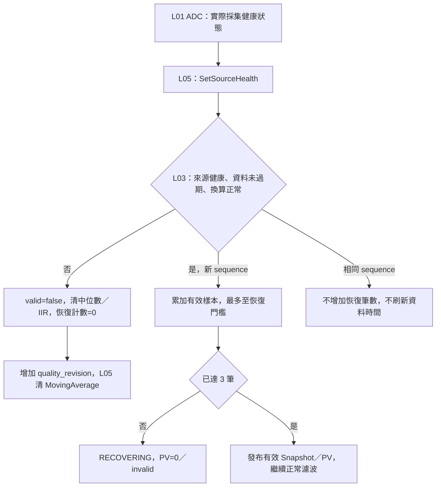

# 感測器來源失效、資料過期與恢復

2026-11-26：補齊產品 CH0～CH3 的量測品質傳遞與濾波恢復。共用 PlatformCore 維持原 gitlink，修改集中於產品 Driver、量測服務及 L05 整合。

## 1. 行為與參數

| 條件 | 現在的處理 |
|---|---|
| ADC 取得診斷異常／CRC／I/O 等拒收資料 | L01 `sample_fault_active=true`，普通 NOT_READY 不清除此旗標；下一筆實際接受的正常樣本才解除 |
| ADC offline 或 Driver 未初始化 | L05 發布不健康來源狀態給 L03；不再僅依賴舊 latest.valid |
| 相同 sequence 持續 500 ms | L03 標記 STALE、輸出無效、清除濾波歷史。相同 sequence 不刷新時間 |
| 換算失敗／CJC 無效／超規／超量程 | 標記 CONVERSION、保留換算錯誤碼與 flags；先檢查當筆校正 μV，避免中位數掩蓋當筆異常 |
| 啟動、恢復或 Sensor type／CJC 設定改變 | 需要連續 3 筆有效新 sequence，前 2 筆為 RECOVERING，第 3 筆才發布有效 PV |
| 恢復途中再次失效 | 歸零恢復計數，重新清除歷史；原本同一筆快取不能當成恢復新樣本 |
| 無效期間 | Snapshot.valid=false、工程值及 Modbus unfiltered／filtered PV=0；須搭配錯誤碼判讀零值 |
| Fault／Safety lock | 不因本次量測恢復自動清除系統 Fault、MCU 過溫／低電壓鎖存，也不新增自動啟動控制 |

參數位於 [ProductSensorMeasurementConfig.h](../../Config/ProductSensorMeasurementConfig.h)：

- `PRODUCT_SENSOR_STALE_TIMEOUT_MS=500U`，允許 1～INT32_MAX ms。
- `PRODUCT_SENSOR_RECOVERY_GOOD_SAMPLES=3U`，允許 1～65535。

這是產品預設策略，不是經實機量測的安全反應時間保證。預設 TC 50 SPS 下，3 筆代表 3 次有效採集事件，不代表 3 次主迴圈或固定 60 ms。

## 2. 狀態與資料流



L03 `ProductSensorMeasurementService_SetSourceHealth()` 僅發布來源資訊，接著由同一前景路徑的 `ProcessAt()` 套用。來源狀態尚未發布時採 SOURCE_UNKNOWN，不能默認健康。正常 main 已於各通道 `ProcessAt()` 前接入 route／AnalogInput diagnostics／產品 ADC diagnostics。

## 3. 各級濾波清除

| 濾波 | 失效時 | 恢復時 |
|---|---|---|
| L03 5 點中位數 | `median_initialized=false` | 第一筆有效恢復樣本重新 seed，恢復期間只加入新的有效樣本 |
| L03 IIR | `filter_initialized=false`，快取清零 | 恢復門檻達成時，以當次中位數換算結果 seed，避免沿用失效前 IIR |
| L05 MovingAverage | `ProductFbMovingAverageAdapter_Reset()` 清除 buffer state／output | 第 3 筆由 L03 確認的有效量測開始建立新的平均視窗 |

L03 Snapshot 新增 `quality_revision`。L05 每輪 FB 整合先檢查 revision 與品質，失效可在尚未到 20 ms callback 時立即清除平均快取；即使失效與恢復都發生於兩次 callback 之間，也不會混入前一個視窗。Reset 保留 callback_count 等排程診斷。

品質有效條件也套用至 MovingAverage／原始 Alarm／PV processing Provider：`valid`、`quality_flags==0`、`input_error==61`、`conversion_flags==0`、有效時間戳、資料年齡及溫度 Sensor type。PV processing 原先將正常碼視為 0 的不一致已修正為 61。PV processing 與 Alarm 原有更嚴格的 age 規則仍各自生效。

## 4. 旗標與錯誤碼

Snapshot 新增 `quality_flags`、`recovery_good_samples`、`quality_revision`、`sample_age_ms`。flags 可組合，例如 SOURCE_FAULT 與 STALE 同時成立。

| bit | 名稱 | 意義 |
|---|---|---|
| 0 | NO_SAMPLE | 尚無可取得的來源樣本 |
| 1 | SOURCE_FAULT | ADC offline、未初始化或最近一次採集遭異常拒收 |
| 2 | STALE | 資料年齡達過期門檻 |
| 3 | CONVERSION | 設定、校正、CJC、超規／超量程等換算品質異常 |
| 4 | RECOVERING | 正在等待連續有效新樣本 |
| 5 | DISABLED | Sensor type OFF |
| 6 | SOURCE_UNKNOWN | 尚未發布來源健康狀態 |

既有錯誤碼維持用途；新增 `144=STALE`、`145=RECOVERING`、`146=SOURCE_FAULT／UNKNOWN`。正常維持 `61`，無樣本維持 `140`。超規／超量程仍分別是 142／143，但現在不發布為可供下游使用的有效 PV。

`processed_timestamp_ms` 仍為軟體首次處理該 sequence 的時間，不是 ADC 硬體捕獲時間。`sample_age_ms` 依產品單調時鐘與首次觀察 sequence 的時間計算，未知時為 UINT32_MAX。若主迴圈長時間停頓後已取得新樣本，也先依前次資料年齡清歷史，再進入恢復。32-bit 時鐘回繞以無號差值處理，需於一個時鐘回繞內持續執行。

正式路徑使用 `ProcessAt(channel, now_ms)`。保留的無時間 `Process()` 僅供相容呼叫，不提供資料過期保證，也不產生虛構時間戳；正式產品不可混用兩種時鐘入口。

## 5. Modbus 唯讀品質區

支援 FC03／FC04，FC06／FC10 寫入拒絕。各通道每次讀回一組 8 words，32-bit 數值 high word 在前。CH0 的既有 PV 位址不改動。

| 通道 | 起點 | 範圍 |
|---|---|---|
| CH0 | 49A0h | 49A0h～49A7h |
| CH1 | 49A8h | 49A8h～49AFh |
| CH2 | 49B0h | 49B0h～49B7h |
| CH3 | 49B8h | 49B8h～49BFh |

| Offset | 型別 | 內容 |
|---|---|---|
| +0 | U16 | quality_flags |
| +1 | U16 | recovery_good_samples，達門檻後停在門檻 |
| +2／+3 | U32 | Snapshot sample_sequence，最後進入換算的樣本識別 |
| +4／+5 | U32 | sample_age_ms，FFFFFFFFh 代表未知 |
| +6／+7 | U32 | quality_revision，歷史失效代次 |

```powershell
python E:\myGitHub\myNXPs16_Prj\_Product\Tools\safety_modbus_test.py --port COM8 read 0x49A0 8
```

此命令只讀值，不會自動完成斷線測試或將讀取成功判定為功能 PASS。每個回覆由前景已保存的 monitor image 組成，請整組讀取以減少不同時刻的欄位混用。

## 6. Host 驗證與待實機項目

```text
python _Product/Tests/run_sensor_recovery_tests.py --sanitize
python _Product/Tests/run_alarm_logic_tests.py --sanitize
python _Product/Tests/run_factory_calibration_tests.py
python _Product/Tests/run_ch0_pid_test.py
python _Product/Tests/MCU/run_host_checks.py
python _Product/Tests/test_safety_evk_mode.py
```

新測試涵蓋啟動 1／2／3 筆、重複 sequence、499／500 ms、恢復中斷、舊快取隔離、raw 超量程先於中位數、median／IIR 清除、通道獨立、時鐘回繞、長前景間隔、OFF／ON，以及 L01 debug 開／關的健康旗標。L05 回歸檢查失效代次跨 callback、非到期時立即清窗、來源品質與單位。Register 回歸檢查四通道影像、word order、邊界及唯讀拒寫。

舊換算回歸以明確 `PRODUCT_SENSOR_RECOVERY_GOOD_SAMPLES=1` 隔離既有算術測試；新恢復測試使用正式預設 3，未因測試而改變產品預設值。

待測：正式板各 Sensor type 真實拔線／接回、資料停止更新、門檻與前景負載延遲、實際輸出與系統 Fault 分工。TC／0–20mA 等實體斷線若仍產生合理數值，單靠本次軟體品質標記無法可靠辨識，仍須以硬體開路診斷／burnout 或量程策略及板級實測確認。CJC 快取本身的年齡策略亦非本次新增的 ADC sequence 過期判斷。
