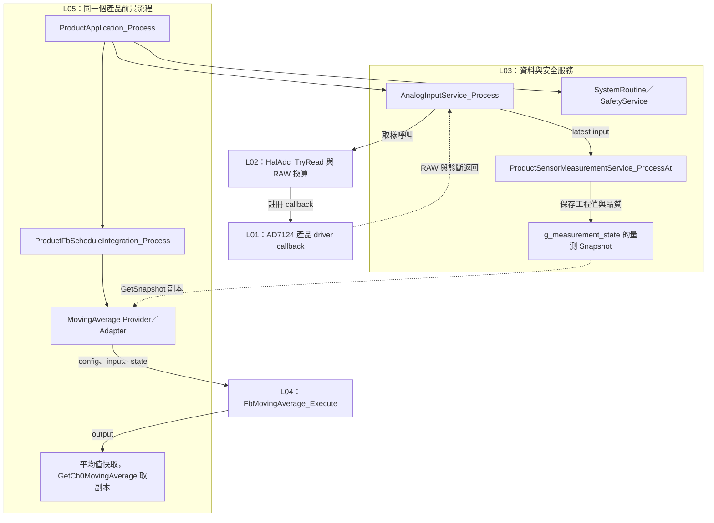

# 系統分層功能堆疊圖與函式清單

## 1. 範圍與圖例

查核基準：APP 分支 `branch2_ver2_directUpdate`、commit `562e5a3d31bf388b79bf258bd4853712bc0c8959`；PlatformCore 子模組 `73adb19bbb71016b4d4be750c5e42b2e33fa4a0c`。本文件以目前主要功能、對外入口與重要排程 callback 為範圍；不是 SDK 全函式或全部 static helper 的符號表。

- **已接入**：目前產品流程有呼叫點，仍依組態及輸入決定是否實際工作。
- **預設停用／待串接**：有模組或介面，不代表正式控制鏈已運行。
- **測試專用**：需特定建置巨集；不列為正式產品功能。

總圖由上至下表示職責堆疊；連線表示層級關係，並非每筆資料必經 L05→L04→L03。實際呼叫與返回方向見第 8 節。各函式的觸發時間與週期另見[架構與執行時機](LAYER_ARCHITECTURE_AND_EXECUTION_TIMING.md)。

## 2. 系統功能堆疊總圖

```mermaid
flowchart TD
    ENTRY["APP 入口：main／SysTick_Handler／while(1)"]
    subgraph L5["L05 Application：產品組裝與排程"]
        direction LR
        A5["產品流程與安全來源
ProductApplication_Process
ProductLowVoltageSafety_Process
ProductMcuTemperatureSafety_Process"]
        B5["FB 排程、Provider 與 Adapter
ProductFbScheduleIntegration_Process
ProductPvProcessing_Process
ProductAlarmLogicAdapter_Process
ProductFbMovingAverageAdapter_Process"]
        C5["產品狀態與選配控制
ProductStatusLed_Process
ProductPidControllerAdapter_Process：選配"]
    end
    subgraph L4["L04 FunctionBlock：共用運算庫"]
        direction LR
        A4["量測與訊號運算
MovingAverage／Linearization
InputSwitchOver／LeadLag／DeadTime
WeightedSum／Divide／Selector"]
        B4["控制與程序
Pid／PidGroupSelector／SetpointRamp
ProfileSequencer／Feedforward
CascadeCoordinator／OutputLimiter
PowerVoltageCompensation"]
        C4["警報、診斷與記錄
Alarm／MultiChannelAlarm／Logic
InBandTimer／HeaterResistance
ProcessResponse／BatchMetrics／RecordTrigger"]
    end
    subgraph L3["L03 System：系統與協議服務"]
        direction LR
        A3["SystemRoutine 與安全
Safety／SystemFault／Warning
SystemEvent／Snapshot"]
        B3["採集、轉換、設定與保存
AnalogInput／SensorConversion
Measurement Snapshot／Calibration
Configuration Consumer／NVM
DigitalInput／DigitalOutput／PWM"]
        C3["通訊與系統命令
Modbus Slave／Master／Register Adapter
USB Modbus／Serial Apply
APP Firmware Update"]
    end
    subgraph L2["L02 BSP 與 PlatformHAL：介面轉接"]
        direction LR
        A2["產品 BSP
BspInternalAdc／BspRs485
BspAnalogOutput／BspStatusLed"]
        B2["共用 HAL
HalAdc／HalAdcMeasurement
HalDac／HalPwm／HalGpio
HalSerial／HalNvm"]
    end
    subgraph L1["L01 ProductDriver：產品硬體實作"]
        direction LR
        A1["輸入與板級狀態
AD7124／Internal ADC／LowVoltage
Digital IO／DIP／Rotary"]
        B1["通訊與輸出
RS485 DMA／Direction／USB CDC／CAN
PWM／DAC8562／LED"]
        C1["保存、更新與監督
NVM／FRAM
FW Update Board／Watchdog"]
    end
    HW["板級設定與 SDK：Pins／Clock／Peripheral／IRQ
硬體：SPI ADC、LPADC、USART、USB、MCAN、CTIMER、GPIO、FRAM、WWDT"]
    ENTRY --> L5
    L5 --- L4
    L4 --- L3
    L3 --- L2
    L2 --- L1
    L1 --- HW
```

L04 方塊內省略共同 `Fb` 字首，完整名稱在第 4 節列出。L04 本身沒有硬體採樣、獨立計時器或背景執行緒；實例 state、來源、參數、呼叫時機及結果去向由 L05 組裝。

`main()` 位於 `source/`，不是額外命名為 L06 的層。Bootloader 為另一映像；本圖僅列 APP 更新入口與板級交接。

## 3. L05：產品應用層功能與函式

位置：`_Product/Source/L05_Application/`。

| 功能模組 | 主要函式／callback | 目前接入狀態 |
|---|---|---|
| 應用總流程 | `ProductApplication_Init()`、`ProductApplication_Tick1ms()`、`ProductApplication_Process()` | 已接入 main；負責 due flags、服務順序與產品串接 |
| FB 排程核心 | `ProductFbSchedule_Init()`、`ProductFbSchedule_Process()` | 檢查 enabled、到期、實際 elapsed_ms；逾期只呼叫一次 |
| FB 整合／來源設定 | `ProductFbScheduleIntegration_Init()`、`ProductFbScheduleIntegration_Process()`、`ProductFbScheduleIntegration_ConfigureCh0PvProcessing()`、`ProductFbScheduleIntegration_SetCh0AlarmPvSource()` | 任務表與各 Adapter 實例由本模組持有 |
| CH0 PV 候選處理 | `ProcessCh0Pv()`（內部 callback）、`ProductPvProcessing_Init()`、`ProductPvProcessing_SetConfig()`、`ProductPvProcessing_Process()`、`ProductPvProcessing_GetOutput()` | 20 ms 任務已接；預設來源 CH0、bypass，未啟用雙來源切換 |
| Alarm／Logic 組裝 | `ProductAlarmLogicAdapter_Init()`、`SetAlarm()`、`SetSetpoint()`、`SetLogic()`、`Command()`、`SetPidStep()`、`Process()`、`GetAlarm()`、`GetLogic()` | 此列省略重複的 `ProductAlarmLogicAdapter_` 字首；20 ms callback 已接，各 Alarm／Logic slot 預設停用 |
| CH0 移動平均 | `ProductFbMovingAverageAdapter_Init()`、`ProductFbMovingAverageAdapter_Process()`、`ProductFbMovingAverageAdapter_GetOutput()`、`ProductFbScheduleIntegration_GetCh0MovingAverage()` | 20 ms 任務，5 筆視窗；僅新有效 sequence 收樣，結果未自動接 PID／PWM |
| PID 產品封裝 | `ProductPidControllerAdapter_Init()`、`ProductPidControllerAdapter_SetParameter()`、`ProductPidControllerAdapter_Reset()`、`ProductPidControllerAdapter_Process()`、`ProductPidControllerAdapter_GetOutput()` | 有介面；正式 PID callback 未接，CH0 固定 MV 路徑為選配測試 |
| 低電壓安全來源 | `ProductLowVoltageSafety_Initialize()`、`ProductLowVoltageSafety_Process()`、`ProductLowVoltageSafety_GetSnapshot()` | 產品判斷後送 L03 系統 Fault／Safety |
| MCU 過溫安全來源 | `ProductMcuTemperatureSafety_Initialize()`、`ProductMcuTemperatureSafety_Process()` | 使用 L01 已確認的過溫狀態，不在每輪監看重複累加樣本 |
| 狀態 LED 策略 | `ProductStatusLed_Initialize()`、`ProductStatusLed_Tick1ms()`、`ProductStatusLed_Process()` | RUN／COMM／Error 的產品顯示策略 |

目前任務表共 20 筆，啟用 3 筆：PV、Alarm／Logic、MovingAverage。其他預留任務不是「L04 沒有實作」，而是尚未接入這份產品排程表。詳細名單見[FB 排程](L05_FB_SCHEDULE.md)。

來源：[ProductApplication](../../Source/L05_Application/product_application.c)、[整合任務表](../../Source/L05_Application/product_fb_schedule_integration.c)、[Alarm／Logic 介面](../../Source/L05_Application/product_alarm_logic_adapter.h)。

## 4. L04：共用功能塊庫清單

位置：`_Modules/PlatformCore/L04_FunctionBlock/`。以下列出 25 個已實作模組、26 個公開 FBD 入口；`FbSignalLinearization` 模組有輸入／輸出兩個入口。模組存在、Host 驗證、產品串接與 MCU 實測是不同狀態。

| 分組 | 功能塊／入口 | 功能 |
|---|---|---|
| Utility | `FbMovingAverage` | 固定筆數移動平均 |
| Utility | `FbLinearization` | 通用折線插值核心 |
| Utility | `FbInputLinearization`、`FbOutputLinearization`（`FbSignalLinearization`） | 輸入／輸出折線包裝 |
| Utility | `FbInputSwitchOver` | 雙輸入來源選擇與故障降級 |
| Utility | `FbLeadLag` | 超前／落後運算 |
| Utility | `FbDeadTime` | 訊號延遲 |
| Utility | `FbWeightedSum` | 加權和 |
| Utility | `FbDivide` | 除法與分母保護 |
| Utility | `FbSelector` | 候選值選擇 |
| Utility | `FbLogic` | 邏輯運算 |
| Utility | `FbInBandTimer` | 區間內計時 |
| Control | `FbPid` | PID／On-Off／Auto Tune 後端封裝 |
| Control | `FbPidGroupSelector` | PID 參數組選擇 |
| Control | `FbSetpointRamp` | 設定值斜率限制 |
| Control | `FbProfileSequencer` | Ramp／Soak 程序 |
| Control | `FbFeedforward` | 事件前饋 |
| Control | `FbCascadeCoordinator` | 串級主副控協調 |
| Control | `FbOutputLimiter` | 輸出限制 |
| Control | `FbPowerVoltageCompensation` | 電源電壓補償 |
| Alarm | `FbAlarm` | 單來源警報、延遲、保持及峰值 |
| Alarm | `FbMultiChannelAlarm` | 跨來源／通道警報 |
| Diagnostics | `FbHeaterResistance` | 加熱器阻值診斷 |
| Diagnostics | `FbProcessResponse` | 製程步階響應觀測 |
| Diagnostics | `FbBatchMetrics` | 批次統計 |
| Recording | `FbRecordTrigger` | 記錄觸發 |

目前常用的實際函式如下；其他模組的完整介面應從各 Header／README 查閱，不假設全部有相同的 Init／Reset 引腳。

| 功能 | 已核對的主要函式 | 呼叫端 |
|---|---|---|
| 移動平均 | `FbMovingAverage_Init()`、`FbMovingAverage_Execute()` | L05 MovingAverage Adapter |
| 警報 | `FbAlarm_DefaultConfig()`、`FbAlarm_Initialize()`、`FbAlarm_Execute()` | L05 Alarm／Logic Adapter |
| 邏輯 | `FbLogic_DefaultConfig()`、`FbLogic_Initialize()`、`FbLogic_Execute()` | L05 前段／後段 Logic |
| 輸入折線 | `FbInputLinearization_Execute()` | L05 PV processing |
| 來源切換 | `FbInputSwitchOver_Execute()` | L05 PV processing，依 switch 設定 |

`FbC7gLogic` 目前僅規劃，沒有正式 Header／實作，未列入上述已實作庫。PID 的 CKLIB 後端可用性與單位邊界須依其文件及實際建置判讀，不能以 FB 出現在圖中認定實機控制已完成。

完整介面與圖：[L04 FBD 索引](../../../_Modules/PlatformCore/L04_FunctionBlock/FBD_INDEX.md)、[驗證狀態](../../../_Modules/PlatformCore/L04_FunctionBlock/VERIFICATION_STATUS.md)、[產品 FB 文件索引](FB_DOCUMENT_INDEX.md)。

## 5. L03：系統服務層功能與函式

產品實作位於 `_Product/Source/L03_System/`；共用實作位於 `_Modules/PlatformCore/L03_SystemPlatform/`。

| 功能群 | 模組／主要函式 | 職責 |
|---|---|---|
| 系統例行入口 | `SystemRoutine_Initialize()`、`SystemRoutine_ExecuteFast()`、`SystemRoutine_ExecuteControl()`、`SystemRoutine_ExecuteBackground()`、`SystemRoutine_GetStatus()` | 聚合產品 monitor 與系統服務；Background API 存在，但目前產品主流程未呼叫 |
| 安全與故障 | `SafetyService_Process()`、`SafetyService_UpdateSource()`、`SystemFaultService_Raise()`、`WarningService_UpdateSource()` | 安全來源聚合、鎖存／抑制、故障與警告更新 |
| 系統事件／診斷快照 | `SystemEventService`、`SnapshotService`、`FaultService`、`EventService` | 系統事件與故障紀錄；這裡的 Snapshot 不等於量測 Snapshot |
| ADC 採集 | `AnalogInputService_Process()`、`AnalogInputService_RetryDevice()` | 經 HAL 取 RAW、更新 latest input、離線恢復 |
| 量測設定套用 | `ProductSensorConfigurationConsumer_Initialize()`、`ProductSensorConfigurationConsumer_Process()` | 消費設定事件、套用 sensor／ADC 並 ACK |
| 工程值轉換 | `ProductSensorMeasurementService_Initialize()`、`ProductSensorMeasurementService_ProcessAt()`、`ProductSensorMeasurementService_GetSnapshot()` | 校正、電壓中位數、TC／RTD／線性轉換、量測 Snapshot 與 IIR |
| 表格與範圍 | `SensorConversionService_Convert()`、`PiecewiseLinearTable_Evaluate()`、`ProductTemperatureRangeResolver_Resolve()` | 感測器換算、折線插值、合法範圍解析 |
| 工廠校正 | `FactoryCalibrationService_Convert()`、`FactoryCalibrationService_UpdateLiveMicrovolts()`、`ProductFactoryCalibrationStorage_Initialize()`、`ProductFactoryCalibrationStorage_GetStatus()` | 校正參數、即時 μV 與產品保存後端；命令由服務介面受理 |
| 設定事件與保存 | `AlarmConfigurationEventConsumer_Process()`、`SafetyConfigurationEventConsumer_Process()`、`NvmConfigurationEventConsumer_Process()`、`NvmService_Process()` | 設定套用、ACK 與 NVM 保存狀態機；Alarm／Safety Consumer 實體檔案位於 L04/src，屬跨層設定整合 |
| DI／DO／PWM 服務 | `DigitalInputService_Process()`、`DigitalInputService_GetSnapshot()`、`DigitalOutputService`、`PwmOutputService_RefreshSafety()` | 輸入狀態、輸出服務與安全變更刷新 |
| RS485 Slave | `L03_ProductModbus_Init()`、`L03_ProductModbus_Tick1ms()`、`L03_ProductModbus_Process()` | RTU／ASCII、站號、完整請求及回覆推進 |
| RS485 Master | `L03_ProductModbusMaster_Submit()`、`L03_ProductModbusMaster_Process()`、`L03_ProductModbusMaster_GetResult()` | 明確提交交易、回應／逾時與結果；不自動建立網路輪詢表 |
| USB 協議入口 | `ProductUsbModbus_Init()`、`ProductUsbModbus_Process()` | USB CDC 共用 Modbus Register Map |
| 共用協議核心 | `ModbusSlave`、`ModbusMaster`、`ModbusCore`、`SerialService`、`SerialConfigurationApplyService` | FC03／04／06／10、framing、串口設定與先回覆後切換 |
| 產品 Register 轉接 | `ProductModbusRegisterAdapter_GetInterface()` 及 Read／Write callbacks | Register 位址、值、Pending／Apply 與各服務對映 |
| 更新入口 | `ProductFwUpdate_Init()`、`ProductFwUpdate_Read()`、`ProductFwUpdate_Write()`、`ProductFwUpdate_ReplySent()`、`ProductFwUpdate_Process()`、`ProductFwUpdate_Quiesce()`、`ProductFwUpdate_Reset()` | APP 更新命令、安全停機與交接；另使用共用 `FwUpdateApp` 庫 |
| FRAM 命令測試 | `ProductFramBankTest_Start()`、`ProductFramBankTest_Abort()`、`ProductFramBankTest_Process()`、`ProductFramBankTest_IsBusy()` | 明確測試命令才有工作；忙碌時暫停產品 NVM consumer 推進 |

函式名稱與檔案目錄不是完全相同的責任分類：共用設定 Consumer 的實體位置保留既有架構，不能為了圖面整齊而誤稱它們全在 L03 目錄。

來源：[產品量測](../../Source/L03_System/product_sensor_measurement_service.c)、[產品 Register 介面](../../Source/L03_System/product_modbus_register_adapter.h)、[SystemRoutine](../../../_Modules/PlatformCore/L03_SystemPlatform/SystemRoutine/SystemRoutine.h)。

## 6. L02：BSP 與 HAL 功能及函式

| 位置／模組 | 主要函式／介面 | 責任 |
|---|---|---|
| 產品 BSP：Internal ADC | `BspInternalAdc_Initialize()`、`BspInternalAdc_RequestCjcSamples()`、`BspInternalAdc_RequestMcuTemperature()`、`BspInternalAdc_Process()`、`BspInternalAdc_GetCjcTemperature()`、`BspInternalAdc_GetMcuTemperature()` | 冷端／MCU 溫度產品入口與快取 |
| 產品 BSP：RS485 | `BspRs485_StartReceive()`、`BspRs485_TakeReceivedFrame()`、`BspRs485_SetRtuTimingUs()`、`BspRs485_StartSlaveResponseDelayUs()` | 方向、接收與 RTU 時序轉接 |
| 產品 BSP：Analog output | `BspAnalogOutput_Initialize()`、`BspAnalogOutput_WriteCode()`、`BspAnalogOutput_WriteDacMicrovolts()`、`BspAnalogOutput_GetLastCode()` | DAC code／μV 操作與末次值 |
| 產品 BSP：Status LED | `BspStatusLed_Initialize()`、`BspStatusLed_Write()` | 板級 LED 操作 |
| 共用 HAL：ADC | `HalAdc_Initialize()`、`HalAdc_Configure()`、`HalAdc_TryRead()` | 以已註冊 callback 存取產品 ADC |
| 共用 HAL：RAW 換算 | `HalAdcMeasurement_CodeToMicrovolts()` | ADC code→μV 的同步數值換算 |
| 共用 HAL：其他周邊 | `HalDac`、`HalPwm`、`HalGpio`、`HalSerial`、`HalNvm` | 周邊無關介面，將操作轉交 L01 已註冊 driver |

BSP 位於 `_Product/Source/L02_BSP/`；共用 HAL 位於 `_Modules/PlatformCore/L02_PlatformHAL/`。HAL callback 使共用庫不必直接依賴 AD7124 或 LPC55S16 SDK；BSP 不保證每次都先繞過一個同名 HAL。

## 7. L01：產品 Driver 功能與函式

位置：`_Product/Source/L01_ProductDriver/`。此層包含晶片操作、產品 pin／bus 綁定與部分硬體事件狀態機。

| 功能 | 主要函式／callback | 硬體／責任 |
|---|---|---|
| 外部 ADC | `ProductAdcDriver_Init()`、`ProductAdcDriver_GetRoutes()`、`ProductAdcDriver_GetDeviceConfig()`、`ProductAdcDriver_GetDiagnostics()`、`ProductAdcDriver_AuditNextDevice()`、`ProductAdcTryReadInternal()`（內部 callback） | AD7124 路由、採集與診斷；下接 `ProductAd7124_InitDevice()`／ADI driver |
| 內部 ADC | `ProductInternalAdcDriver_Init()`、`ProductInternalAdcDriver_RequestCjcSamples()`、`ProductInternalAdcDriver_RequestMcuTemperature()`、`ProductInternalAdcDriver_Process()`、`ProductInternalAdcDriver_GetSnapshot()` | LPADC RAW、TMP20 CJC、MCU 溫度與過溫確認 |
| 低電壓輸入 | `ProductLowVoltageDriver_Initialize()`、`ProductLowVoltageDriver_IsActive()`、`ProductLowVoltageDriver_NotifyInterrupt()` | GPIO／PINT 通知；產品連續樣本安全判斷在 L05 |
| 數位 I/O | `ProductDigitalIoDriver_Init()` | GPIO 與 HAL callbacks |
| DIP／旋鈕 | `ProductDipSwitchDriver_Initialize()`、`ProductDipSwitchDriver_Process()`、`ProductDipSwitchDriver_GetSnapshot()`；`ProductRotarySwitchDriver_Initialize()`、`ProductRotarySwitchDriver_Process()`、`ProductRotarySwitchDriver_GetSnapshot()` | 實體開關狀態 |
| RS485 整合 | `ProductRs485Driver_Initialize()`、`ProductRs485Driver_Process()`、`ProductRs485Driver_StartReceive()`、`ProductRs485Driver_TakeReceivedFrame()` | 產品 HAL 註冊與收發轉接 |
| RS485 DMA／方向 | `ProductRs485Dma_Init()`、`ProductRs485Dma_SendAsync()`、`ProductRs485Dma_Process()`、`ProductRs485Direction_BeginTransmit()`、`ProductRs485Direction_ForceReceive()` | USART TX／RX DMA、MRT RTU 計時、DE／RE |
| USB CDC | `ProductUsbCdc_Init()`、`ProductUsbCdc_Process()`、`ProductUsbCdc_Read()`、`ProductUsbCdc_Send()`、`ProductUsbCdc_TxReady()`、`ProductUsbCdc_Stop()` | USB stack、端點與資料收發；另有 descriptor／OSA 配套 |
| CAN | `ProductCanDriver_Init()`、`ProductCanDriver_Process()`、`ProductCanDriver_Send()`、`ProductCanDriver_Receive()`、`ProductCanDriver_GetDiagnostics()` | MCAN、TX／RX queue 與 bus-off 診斷；不是完整 CANopen／PDO 排程 |
| PWM | `ProductPwmDriver_Init()` 及註冊的 HAL callbacks | CTIMER 硬體波形與更新 |
| DAC | `ProductDac8562Driver_Init()` 及註冊的 HAL callbacks | DAC8562 SPI 輸出 |
| LED | `ProductLedDriver_Initialize()`、`ProductLedDriver_Write()` | LED GPIO 實作；顯示策略在 L05 |
| NVM／FRAM | `ProductNvmDriver_Init()` 及註冊的 HAL callbacks | FRAM 實際讀寫；保存政策在 L03 |
| 更新板級配套 | `product_fw_update_board.c` | 更新交接所需板級操作，與 L03 更新協議分工 |
| Watchdog | `ProductWatchdogDriver_StartRuntime()`、`ProductWatchdogDriver_Process()` | runtime WWDT 驗證／餵狗，於主迴圈尾端推進 |

底層另包含 `board/`、`drivers/`、`startup/`、`device/` 的 Pins／Clock／SDK／中斷向量。`SysTick_Handler()` 只累加 100 μs 時基；MRT、USB、LPADC、DMA callback 負責短事件處理，完整服務多在主迴圈推進。

## 8. 實際互動：L04 運算支線與 L03 採集支線

圖中的「latest input→量測」為資料關係，兩個 Process 的確切呼叫順序仍由 `ProductApplication_Process()` 決定。L05 也直接呼叫部分 L01 driver；不是強制每次逐層轉接。

MovingAverage 結果目前不自動覆蓋 L03 Snapshot、Modbus 的 IIR PV 或 PWM。溫度量測 Snapshot 與故障 Snapshot 是兩套不同資料。現有 PV Provider 的 `input_error == 0` 與正常量測代碼 `61` 不一致等已知串接限制，依[TC 與濾波資料流](TC_TO_SNAPSHOT_MOVING_AVERAGE_FLOW.md)判讀，本文件未修改該行為。

## 9. 測試功能在堆疊中的位置

| 層級 | 測試入口／狀態 | 與正式功能的區別 |
|---|---|---|
| L01 | `ProductInternalAdcDriver_SetMcuTemperatureTestOverride()` | 僅對應測試組態開放，不視為正式 ADC API 可用保證 |
| L01 | `ProductCanTest_Process()` | `PRODUCT_CAN_TEST_BUILD` 專用 |
| L03 | `ProductSafetyTest_Read()`、`ProductSafetyTest_Write()`、`ProductSafetyTest_Process()` | SafetyTest 命令與注入，依建置與 addressed request 防護 |
| L05 | `ProductFbScheduleIntegration_ConfigureCh0PidTest()` 等 CH0 PID 測試 API | `PRODUCT_PID_CH0_TEST_ENABLED` 選配固定 MV 測試，並非正式 CKLIB 控制完成 |
| L05 | `TraceCh0Process()`（內部 callback） | `PRODUCT_FB_CH0_TRACE_ENABLED` 包裝 MovingAverage 以記錄執行資訊 |

本次僅新增文件與導覽，沒有變更功能開關、排程、控制輸出或測試入口。圖與表表示程式結構，不代表新增 MCU／實體輸出驗證結果。
