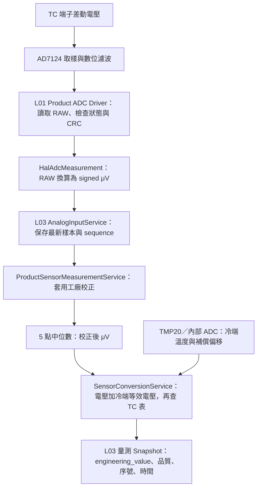
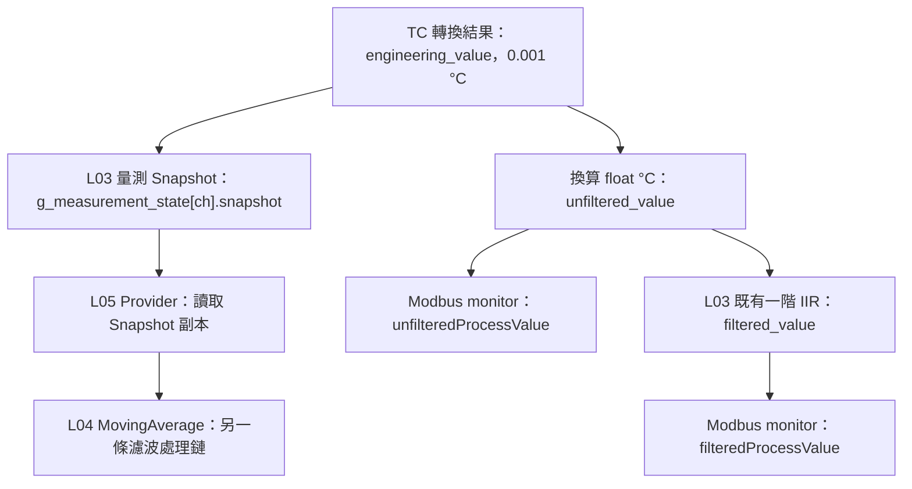
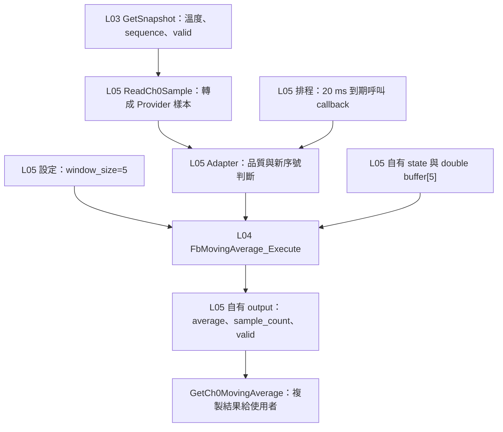
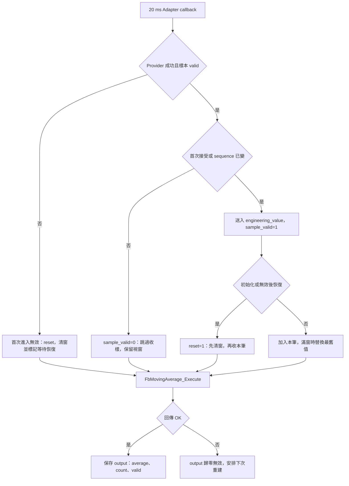
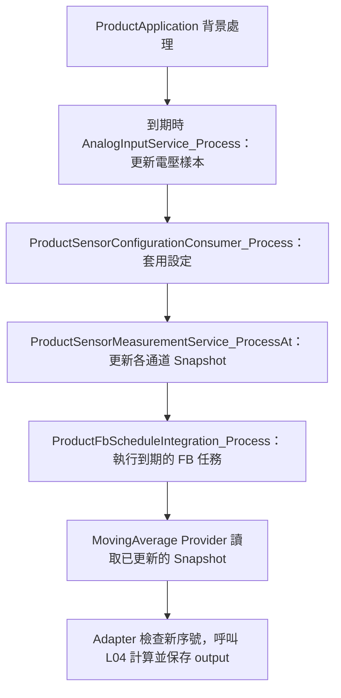

# TC 電壓、溫度 Snapshot 與 L05 MovingAverage 資料流

> 2026-11-26 更新：已加入來源健康、500 ms 過期、3 筆新有效樣本恢復與各級濾波清除。品質旗標、寄存器與 Host／實機範圍見[感測器失效與恢復](SENSOR_DISCONNECT_RECOVERY.md)。下列原始串接說明已依新策略修訂。

## 1. 本文範圍與版本

本文依 `branch2_ver2_directUpdate` 的 `a20dff4540a4f9a97e202f4800a83743da23fecb` 及其 PlatformCore 子模組 `73adb19bbb71016b4d4be750c5e42b2e33fa4a0c` 說明現有程式。本文新增文件，未新增或改動濾波程式。

案例採用現有 `FbMovingAverage`，以最近 N 筆有效新溫度的算術平均進行平滑。它具有低通效果，但與「時間常數 τ 的一階 IIR／LPF」是不同演算法，參數不能直接互換。

目前已有 CH0 的「L03 溫度 Snapshot → L05 Adapter → L04 MovingAverage」唯讀串接，視窗 5 筆、排程 20 ms。以下先說明這條現有路徑，再說明新增另一個濾波實例需要做哪些工作。

## 2. TC 電壓如何變成溫度

### 2.1 量測與轉換資料流



這是資料處理方向。實際呼叫由上層發起：`AnalogInputService_Process()` 呼叫 `HalAdc_TryRead()`，HAL 再透過已註冊的 driver callback 到 L01 讀取硬體。L01 不主動呼叫 L05。

| 階段 | 程式位置／入口 | 資料與工作 |
|---|---|---|
| 讀取 AD7124 | [product_adc_driver.c](../../Source/L01_ProductDriver/product_adc_driver.c) 的 `ProductAdcTryReadInternal()` | 呼叫 `ADI_AD7124_TryReadDataDiagnostic()`，取得 `raw_code`、ADC channel 與狀態；故障樣本及重新設定後需丟棄的第一筆不當成正常新資料 |
| RAW 轉 μV | [HalAdcMeasurement.c](../../../_Modules/PlatformCore/L02_PlatformHAL/src/HalAdcMeasurement.c) | 依參考電壓、gain、bipolar 設定做帶符號換算，結果放入 `HalAdcSample_t.microvolts` |
| 保存電壓樣本 | [AnalogInputService.c](../../../_Modules/PlatformCore/L03_SystemPlatform/SystemService/AnalogInputService/AnalogInputService.c) | 依 route 分到 logical input，寫入 `g_input_latest[logical_input]`，每筆成功新樣本遞增 `sequence` |
| 工廠校正 | [product_sensor_measurement_service.c](../../Source/L03_System/product_sensor_measurement_service.c) 的 `ProcessMeasurement()` | 依 sensor type 選取校正 profile，呼叫 `FactoryCalibrationService_Convert()`，將量測 μV 轉成校正後 μV |
| 中位數處理 | 同檔 `FilterMedian()` | 對每通道校正後 μV 做 5 點中位數。不同 ADC sequence 才推進視窗，第一筆填滿初始視窗以避免零值偏移 |
| TC 轉溫度 | [SensorConversionService.c](../../../_Modules/PlatformCore/L03_SystemPlatform/SystemService/AnalogInputService/SensorConversionService.c) | 冷端溫度查 CJC 表得到等效 μV，與 TC μV 相加，再以該 TC 類型的 measurement table 做分段線性換算 |

雙極 ADC 的電壓換算可表示為：

```text
microvolts = ((RAW - 2^23) × reference_uv) / (2^23 × gain)
```

程式使用整數中間運算並檢查範圍。實際參考電壓與 gain 取自該通道的設定，不能把所有 TC 類型都假設成相同 gain。

TC 溫度換算可表示為：

```text
E_total = median(calibrated TC μV) + E_TC(cold_junction_temperature)
temperature_millicelsius = TC_measurement_table(E_total)
```

冷端補償在電壓域相加，不是先查出 TC 差溫後直接加上冷端攝氏溫度。

### 2.2 冷端來源與單位

`ProcessMeasurement()` 對 CH0／CH1 使用 CJC index 0，CH2／CH3 使用 index 1。內部 TMP20 來源經 `BspInternalAdc_GetCjcTemperature()` 取得 `centi_c`，加上 `cjcOffsetCentiC` 後乘 10，交給轉換服務的單位為 `millicelsius`。

停用 CJC 時，轉換服務不查冷端表，等效冷端電壓為零。外部 CJC 來源目前保留，來源無法取得時回報錯誤，不默默改用內部 TMP20。

| 值 | 型別／刻度 | 範例 |
|---|---|---|
| `raw_code` | `uint32_t`，ADC 24-bit code | 不是溫度 |
| `uncalibrated_uv`／`calibrated_uv` | `int32_t`，μV | 1000 表示 1000 μV |
| `cjc_temperature_centi_c` | `int32_t`，0.01 °C | 2500 表示 25.00 °C |
| TC 的 `engineering_value` | `int32_t`，0.001 °C | 25000 表示 25.000 °C |
| L03 的 Float32 PV monitor | `float`，°C | 25.0 表示 25.000 °C |
| 現有 L05 MovingAverage 的 `average` | `double`，沿用輸入的 0.001 °C 刻度 | 25020.0 表示 25.020 °C |

`engineering_value` 也可裝其他感測器的工程值，因此不能只看到欄位名稱就一律當作溫度。新增溫度專用處理鏈時需確認 `sensor_type`。

## 3. Snapshot 放在哪裡，如何取得

### 3.1 儲存位置與生命週期

量測結果存在 `product_sensor_measurement_service.c` 的模組私有靜態陣列：

```c
static ProductSensorMeasurementState_t
    g_measurement_state[PRODUCT_SENSOR_INPUT_COUNT];

/* 每個元素內含： */
ProductSensorMeasurementSnapshot_t snapshot;
```

CH0 對應 `g_measurement_state[0].snapshot`，CH1～CH3 依此類推。這是 RAM 中各通道的最新快照，不是歷史佇列，也不會因讀取而消耗資料；後續量測會更新它。初始化會清除狀態。實際 RAM 位址由該次 linker 配置決定，不能將某次 Debug 地址當成固定介面。

跨層讀取使用公開 API，取得一份副本：

```c
ProductSensorMeasurementSnapshot_t snapshot;
bool available = ProductSensorMeasurementService_GetSnapshot(0U, &snapshot);
```

`available=true` 只表示通道與指標合法、已複製快照，不等於量測有效。仍需判斷 `snapshot.valid` 及用途所需的品質條件。

### 3.2 快照的重要欄位

| 欄位 | 用途與限制 |
|---|---|
| `engineering_value` | TC／RTD 轉換完成的 0.001 °C 整數，尚未經過後述 L03 一階 IIR |
| `sample_sequence` | 對應來源 ADC 樣本，用來辨認新資料；不能用「callback 執行了」替代此判斷 |
| `processed_timestamp_ms` | 此 sequence 第一次處理的產品時鐘時間，不是 ADC 真正採樣的硬體時間 |
| `processed_timestamp_valid` | 使用 `ProcessAt()` 才能取得有效時間；重複序號不刷新時間 |
| `sensor_type` | 說明工程值應如何解讀，也用於檢查切換感測器後是否需重建濾波狀態 |
| `valid` | 轉換可提供結果的旗標，不能單獨取代範圍、錯誤碼與資料新鮮度檢查 |
| `input_error`／`conversion_flags` | 正常量測錯誤碼為 **61**，不是 0；超規格／超量程現標為無效，保留非零 flags 與原錯誤碼 |
| `calibrated_uv` | 中位數處理前的當筆校正電壓，不是送進 TC 表的中位數結果 |

失效路徑現在會清除有效性與工程值，重設中位數／IIR，並經 quality_revision 通知 L05 清除平均視窗。控制鏈仍須檢查正常錯誤碼、flags、型別與資料年齡，不能單看數值。

### 3.3 與其他資料區的差別



目前 L03 一階 IIR 的時間常數來自 Active 的 `filterTimeConstantSeconds`，使用 `alpha=Ts/(tau+Ts)`。其輸出送到 Modbus monitor，並未回寫 `snapshot.engineering_value`。

CH0 的 `1000h～1001h` 為 Float32 未經此 IIR 的 PV，`1005h～1006h` 為 Float32 IIR 後 PV，其他通道每組加 `10h`。L05 MovingAverage 目前讀取 Snapshot，因此沒有再串接這個 L03 IIR 輸出。

此處「未濾波」僅指未經 L03 一階 IIR，ADC 數位濾波與校正電壓的中位數仍已存在。另外，SystemRoutine 的 `SnapshotService` 是事件／故障擷取紀錄，與此量測 Snapshot 不同，L05 MovingAverage 不從故障紀錄區取溫度。

## 4. L05 如何使用 L04 的 MovingAverage

### 4.1 取得 FB 的方式

L04 是已編譯進韌體的共用 C 程式庫。L05 透過 Header 宣告、自己的實例資料及函式呼叫來使用它，不需要執行時向某個服務申請 FB。

| 部分 | 現有位置與責任 |
|---|---|
| L04 介面／演算法 | [FbMovingAverage.h](../../../_Modules/PlatformCore/L04_FunctionBlock/Utility/FbMovingAverage.h)、對應 `.c`，提供 `Init()`／`Execute()` |
| L05 Adapter | [product_fb_moving_average_adapter.h](../../Source/L05_Application/product_fb_moving_average_adapter.h)／[.c](../../Source/L05_Application/product_fb_moving_average_adapter.c)，持有 config、state、buffer、output 及新樣本判斷 |
| L05 產品整合 | [product_fb_schedule_integration.c](../../Source/L05_Application/product_fb_schedule_integration.c)，建立 CH0 實例、指定 Provider、註冊排程 |
| 排程機制 | [product_fb_schedule.c](../../Source/L05_Application/product_fb_schedule.c)，依週期呼叫 callback |

L04 不讀硬體、不知道 CH0，也不自行讀 Modbus 參數。哪些溫度、哪個視窗、何時算，由 L05 負責。

### 4.2 資料、參數與輸出的流向



這張圖描述現有 CH0 實例。`ReadCh0Sample()` 轉接 sequence／工程值，並使用 SnapshotUsable 檢查溫度型別、valid、quality_flags、61 正常碼、conversion_flags、時間戳與年齡。

### 4.3 初始化：實例、緩衝區與視窗

現有整合檔建立一個持續存在的靜態實例：

```c
static ProductFbMovingAverageAdapter_t g_ch0_moving_average_adapter;
```

Adapter 結構內含：

```c
FbMovingAverageState fb_state;
FbMovingAverageConfig fb_config;
FbMovingAverageOutput output;
double buffer[PRODUCT_FB_MOVING_AVERAGE_WINDOW_SIZE];
```

目前 `PRODUCT_FB_MOVING_AVERAGE_WINDOW_SIZE` 在 Adapter Header 定義為 `5U`。`ProductFbMovingAverageAdapter_Init()` 設定 `fb_config.window_size=5`，並呼叫：

```c
FbMovingAverage_Init(&adapter->fb_state,
                     adapter->buffer,
                     PRODUCT_FB_MOVING_AVERAGE_WINDOW_SIZE);
```

`buffer` 與 `state` 都由 L05 擁有，生命週期必須涵蓋所有執行呼叫，不可指向初始化函式返回後就消失的區域陣列。

### 4.4 讀溫度、辨認新樣本、執行計算

現有 Provider 的主要對映如下：

```c
ProductSensorMeasurementService_GetSnapshot(0U, &snapshot);
sample->sample_sequence = snapshot.sample_sequence;
sample->engineering_value = snapshot.engineering_value;
sample->valid = SnapshotUsable(&snapshot); /* 型別、品質與時間 */
```

這是欄位對映摘錄，完整函式另有指標與 API 失敗處理。Adapter 在 callback 中的處理順序為：

1. 呼叫設定好的 `sample_provider(context, &sample)`。
2. Provider 失敗或樣本無效時，將輸出轉為無效，清除視窗並安排恢復後重設。
3. 有效且序號不同時，把 `engineering_value` 轉成 `double`，設 `sample_valid=1`，需要重設時同拍設 `reset=1`。
4. 同序號時設 `sample_valid=0`，不重複累積該筆溫度。
5. 呼叫下列實際 API，結果直接寫進該 Adapter 的 `output`。

```c
adapter->last_status = FbMovingAverage_Execute(
    &adapter->fb_config, &input,
    &adapter->fb_state, &adapter->output);
```

L04 的 `sample_valid=0` 本身只跳過當拍、保留歷史。L05 Adapter 的「量測無效就清窗」是額外的產品策略，兩者不要混為一談。L04 呼叫失敗時，現有 Adapter 會將 output 的數值／筆數清零、`valid=0`，再等待有效新資料重新建立視窗。

### 4.5 算完之後放哪裡

CH0 的濾波結果存在：

```c
g_ch0_moving_average_adapter.output.average
g_ch0_moving_average_adapter.output.sample_count
g_ch0_moving_average_adapter.output.valid
```

使用者透過 [整合層公開 Header](../../Source/L05_Application/product_fb_schedule_integration.h) 取得副本：

```c
FbMovingAverageOutput filtered;
if (ProductFbScheduleIntegration_GetCh0MovingAverage(&filtered) &&
    filtered.valid) {
    double temperature_celsius = filtered.average / 1000.0;
    /* 交給明確指定的下游使用者；此處不自動控制輸出。 */
}
```

`GetCh0MovingAverage()` 讀取的是 L05 快取，呼叫 getter 不會再執行一次濾波。它目前沒有輸出樣本時間與 sensor type，若下游需防止過期值，應擴充產品輸出 metadata 或由 Adapter 提供相應品質資訊。

這個平均值目前不回寫 L03 Snapshot、不覆蓋 `1005h` 的 IIR PV，也不直接寫 PWM／DAC。後續要讓 PID、Alarm 或 Modbus 使用它，需在 L05 明確選擇來源並接上消費者；既有 CH0 Processed PV 路徑也不會自動包含此 MovingAverage。

### MovingAverage 收樣與清窗的分支



圖中 count 是 sample_count 的簡稱。持續無效不需每拍重複 reset，視窗仍保持清空。L04 的跳過樣本與 L05 的品質清窗策略分別呈現。

## 5. 濾波參數與排程如何決定

| 設定 | 目前來源 | 意義 |
|---|---|---|
| 視窗筆數 N | Adapter Header 的 `PRODUCT_FB_MOVING_AVERAGE_WINDOW_SIZE=5U` | 保留最近 5 筆被 L05 接受的有效新樣本 |
| 任務週期 | [ProductFbScheduleConfig.h](../../Config/ProductFbScheduleConfig.h) 的 MovingAverage entry：20 ms | L05 檢查與計算的排程週期 |
| ADC 設定 ODR | [ProductAdcConfig.h](../../Config/ProductAdcConfig.h) 的 `PRODUCT_ADC_OUTPUT_DATA_RATE_HZ=50U` | 本分支目前設定為 50 Hz，應以這個版本的設定為準，不沿用早期 100 Hz 假設 |
| L03 IIR 時間常數 | Active `filterTimeConstantSeconds`，CH0 設定在 `1003h～1004h` | 屬於另一條一階 IIR，不是 MovingAverage 的 N |

理想情況下每 20 ms 收到並接受一筆資料，5 筆平均約對應 100 ms 的樣本數時間尺度，第一筆與第五筆的時間間距是 80 ms。實際視窗依收到的有效新資料決定，不能保證永遠等於固定時間長度。

若 ADC 比 L05 快，Snapshot 只保留最新一筆，兩次 callback 間的中間樣本可能已被覆蓋。這條平均的對象是「L05 接受的最近 N 筆」，不保證每筆 ADC 樣本都納入。若要求完整處理每筆 ADC，需另外設計佇列或配合樣本到達處理。

MovingAverage 沒有 `dt_seconds` 輸入，callback 的 `elapsed_ms` 目前只用於 Adapter 診斷。若要固定時間窗或依不規則樣本間隔加權，需另外定義演算法，不能只改排程就視為完成。

目前沒有 MovingAverage 視窗的正式 Modbus Register 或執行期設定 API。要改固定 N，需同時確保 buffer capacity 足夠並重新建置；要做每通道可調 N，應增加產品設定與驗證，再交給 `FbMovingAverageConfig.window_size`，不能把 IIR 的秒數直接填進去。

## 6. 新增另一個 L05 MovingAverage 任務的工作步驟

現有 CH0 已接妥，新增 CH1 或另一條用途時，可沿用同一套 L04 演算法與 L05 Adapter。以下是接入規劃，本文未執行這些程式變更。

1. **決定來源與單位**：例如選 CH1 的 TC `snapshot.engineering_value`，全程保持 0.001 °C。Provider 需辨認合法溫度 sensor type、品質與資料年齡。讀取失敗或不適用時回報無效，不偽造一筆 0 °C 正常樣本。
2. **新增獨立實例**：在產品整合層宣告另一個 `ProductFbMovingAverageAdapter_t`，各通道擁有獨立 state、buffer、sequence 與 output。
3. **新增／泛化 Provider**：目前 `ReadCh0Sample()` 固定通道 0。CH1 可另寫 Provider，或使用持續存在的 context 傳入 channel；不能直接重用硬編碼 CH0 的 Provider 當成 CH1。
4. **初始化實例**：在 `ProductFbScheduleIntegration_Init()` 中呼叫 `ProductFbMovingAverageAdapter_Init()`，接入正確 Provider；失敗則向上回報，不能讓未初始化實例進入排程。
5. **加入一筆排程**：指定 enabled、period、callback 與新實例 context。callback 可沿用 `ProductFbMovingAverageAdapter_Process`。選擇直接加入 `g_tasks[]` 或擴充任務巨集其中一條路徑，避免同一實例被註冊兩次。
6. **檢查容量與建置**：目前 `g_task_states` 容量使用 `PRODUCT_FB_SCHEDULE_TASK_COUNT`，增加 task 時要同步相應容量定義；L04 `.c` 與 include path 需進入所有預定組態，只有 include Header 不等於完成連結。
7. **公開產品輸出**：新增對應 getter 或通道化 getter，返回平均、valid、來源序號／時間等必要品質資訊。後續消費者應在濾波之後執行；需要同拍依賴時，明確安排 `g_tasks[]` 順序或同一 callback 內的處理順序。
8. **定義重設邊界**：來源通道、sensor type、單位、校正版本等影響數值意義的變更應重建視窗，避免不同資料域混算。目前已透過 quality_revision 處理 Sensor type／CJC 變更與來源失效；新來源、校正版本或其他資料域變更仍需明確納入重設邊界。

任務註冊的形狀如下，名稱是新增時的示意，不代表目前已有該 CH1 API：

```c
/* 示例：在既有任務表中加入，並同步容量與初始化。 */
{true, 20U, ProductFbMovingAverageAdapter_Process,
 &g_ch1_moving_average_adapter},
```

L04 的程式碼可由四通道共用，但四個通道需要四份實例狀態。只有視窗設定可依產品需求共用，平均歷史不可共用。

## 7. 主迴圈中的實際順序

`product_application.c` 在一般產品路徑中先處理 ADC 輪詢及量測，再呼叫 L05 整合排程。SafetyTest EVK 組態會排除部分真實量測與 FB 路徑，不能拿 EVK 注入測試視為這條 TC 實機鏈已通過。



主迴圈可能多次執行，但 ADC 沒有新資料時 `sample_sequence` 不變。20 ms 任務到期也不代表必須把同一筆溫度重複加入平均。

## 8. 用一組溫度確認理解

假設來源都是有效新序號、N=5，下表是說明資料，未宣稱這組數字已在本板實測：

| sequence | 輸入 engineering_value | 輸入 °C | sample_count | average（0.001 °C 刻度） | 平均 °C |
|---|---|---|---|---|---|
| 1 | 25000 | 25.000 | 1 | 25000.0 | 25.000 |
| 2 | 25020 | 25.020 | 2 | 25010.0 | 25.010 |
| 3 | 25040 | 25.040 | 3 | 25020.0 | 25.020 |
| 4 | 25060 | 25.060 | 4 | 25030.0 | 25.030 |
| 5 | 25080 | 25.080 | 5 | 25040.0 | 25.040 |
| 6 | 25100 | 25.100 | 5 | 25060.0 | 25.060 |

收到第一筆即可 `valid=1`，未滿視窗時分母是有效筆數，不是固定 5。第六筆會移除第一筆。重複 sequence 6 不增加筆數，也不把 25100 再算一次。

新增接入後至少確認：相同序號不重複收樣、無效後清窗與恢復、各通道互不污染、單位與視窗設定正確，以及下游取得的是 L05 平均結果。Host 與 MCU 的驗證需各自保存結果，本文的圖與手算表不替代實測。

## 9. 相關入口

- [L05 排程與既有 CH0 MovingAverage](L05_FB_SCHEDULE.md)
- [CH0 MCU 驗證操作](../測試類/L05_CH0_MCU_VALIDATION.md)
- [5 點中位數濾波](SensorMedianFilter.md)
- [CJC 補償來源](CjcSourceSelection.md)
- [工廠校正資料槽](FactoryCalibrationSlots.md)
- [L04 MovingAverage 規格與 FBD](../../../_Modules/PlatformCore/L04_FunctionBlock/Utility/FbMovingAverage/README.md)
- [量測 Snapshot 公開結構](../../Source/L03_System/product_sensor_measurement_service.h)

以上相對連結跟隨目前分支與其子模組。本文開頭記錄查核版本，後續程式調整時需同步檢查資料單位、品質判斷、ODR、排程及輸出位置。

